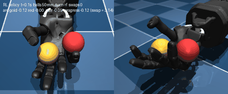

# Shadow Hand Dexterous Manipulation

A fixed-base Shadow Hand E3M5 (24 joints, 20 actuators, 5 fingers) dexterous manipulation project
in MuJoCo -- started right after closing `allegro_hand`, whose main goal (baoding: two balls
circulating around each other in one hand) didn't work on a 4-finger hand.

## Scoping decisions

- **Why the Shadow Hand, and why now.** On the Allegro, every baoding attempt (scripted and RL)
  ran into the hardware: no little finger, a "spread" joint that actually rolls each finger
  about its own length instead of spreading it, and a thumb that can't oppose the fingers well.
  Real baoding leans on exactly those: the thumb and little finger push the balls around a palm
  cupped by the other fingers. The Shadow Hand has all three -- a fifth finger with an extra
  metacarpal joint for cupping (LFJ5), real sideways spread joints (J4), a 5-joint thumb -- and is
  already in `mujoco_menagerie`, so no model-building step.
- **Fixed base, palm up, no arm.** The vendored model lies palm-up out of the box (forearm along
  world +x, palm facing +z, a dropped object lands in the palm), the same working orientation the
  Allegro project used. The 2-joint wrist is part of the model and stays available.
- **Realistic torque limits are kept.** Unlike the Allegro model (no limits at all -- its toss and
  catch needed 1.5 N*m with nothing stopping it), this one caps finger actuators at +-1 N*m, the
  thumb at 1-3 N*m (3 at its base, 2 at its proximal, 1 at the rest), the wrist at 5-10 N*m. Results here are judged inside those limits.
- **Carried over from the Allegro project:** classify every contact by WHICH FACE of WHICH segment
  touches (a contact count was satisfied by the thumb pressing with its back); measure each ball's
  own angle, not the vector between them (one ball wobbling moves that vector too); show the
  starting grasp as an image and get it reviewed before any long training run; stress-test
  controllers under parameter perturbation, not just varied conditions.
- **Simulator: MuJoCo** (`~/robo/venv`, mujoco 3.15), same as every sibling project.

## Staged plan

1. **Vendor the model and verify it under real physics -- DONE.** Copied `mujoco_menagerie`'s
   `shadow_hand` (right hand only, 3.5MB, unmodified -- see `assets/NOTICE.md`).
   `eval_stage1_verify.py` checks, with `mj_step` under gravity rather than forward kinematics:

   - **Tracking**: each of the 20 actuators swept to 25% and 75% of its range (others at rest):
     median steady-state error 0.015 rad. The worst, 0.109 rad, is the little finger's spread
     joint (LFJ4) at 75% -- not a tracking fault: at that angle it swings the little finger INTO
     the ring finger (they touch), and with kp=1 the 0.1 N*m pushback shows up 1:1 as position
     error. Positive LFJ4 moves the little finger toward the ring finger, i.e. inward -- the same
     sign trap the Allegro's spread joint had, so check directions before assuming "spread".
   - **Palmar (inside) face of every segment**: derived from the model, not hardcoded --
     `hand_env.palmar_axis` = (flexion joint axis) x (segment's long axis). It's local -y for the
     fingers but local -x for the thumb's middle segment. All 15 flexion segments move along their
     derived axis when flexed.
   - **Coupled finger joints**: each finger's middle and distal joints (J2, J1) share ONE actuator
     through a fixed tendon, like a human finger. Commanding 1.5 rad splits 0.73 / 0.77.
   - **Gravity**: the scene's ellipsoid object, dropped on the open hand, comes to rest in the palm
     at z=0.038 (palm origin z=0.010), speed 0.0003 m/s.

   <p align="center">
     
   </p>
   <p align="center"><sub>Stage 1: each actuator swept to the top and bottom of its range and back
   (real-time playback), then the object dropped into the open palm.</sub></p>

2. **Contact-face tooling + a stable one-ball hold -- DONE.** One 45mm / 80g ball
   (`assets/scene_one_ball.xml`).

   - **Classifier**: `hand_env.classify_contacts` labels every hand contact on a body by digit,
     segment and FACE -- palmar (pad), DORSAL (back), side, or tip (the very end of a distal
     segment) -- from the contact point's offset from the segment's own long axis, measured against
     `palmar_axis`. `eval_stage2_classifier.py` touches the ball to every flexion segment from known
     directions: 65/65 labelled correctly.
   - **Hold test**: the hand closes on the ball, then gravity is pointed in six directions -- palm
     up, palm DOWN, fingers up, fingers down, either side down (the same physics as turning a
     fixed-base hand over). Held = the ball moves under 1cm in the palm frame over 2s.
   - **Grasp search** (`search_stage2_grasp.py`, cross-entropy method over the 18 finger and thumb
     targets): holding turned out to be the easy part -- most random samples already held in all
     six directions, by caging the ball with fingertip ENDS and the sides of segments. The search
     only found real wraps once the score rewarded pad contacts specifically (and penalized
     fingertip ends), and only found ones that STAY wraps once those contact terms were averaged
     over 7 perturbed copies of each candidate: the first 4-pad grasp lost its pads to the
     4th-decimal rounding of its own targets.
   - **Result** (`hand_env.ONE_BALL_GRASP`, `eval_stage2_hold.py`): mf, rf and lf wrap the ball
     with the palmar faces of their proximal and distal segments. Held in all six directions
     (drift 0.5-1.9mm), peak effort 22% of the force limits; under 100 perturbed trials (every
     target +-0.05 rad, placement +-3mm, mass 40-150g, friction 0.5-1.0) held 100/100, three pads
     on the ball in 85, no dorsal contact in any.

   <p align="center">
     
   </p>

   What it does NOT do: the thumb lies across the palm, off the ball, and the ball is wrapped up
   near the knuckles rather than sitting in the palm. Raising the thumb's weight in the score got
   the thumb on only as a 0.3N graze (`media/stage2_grasp_e_robust_light_thumb.png`); placing the
   ball mid-palm and holding it while the hand closes (it rolls off an open hand) gave grasps that
   held just as well but with a single pad. Left there deliberately: one 45mm ball in a palm built
   for two is a poor stand-in for baoding, where the two touching balls fill the palm's whole
   length and the thumb's job is pushing, not pinching. The earlier search rounds are kept as
   `media/stage2_grasp_{a,b,c}_*.png`.
3. **Two-ball bowl, reviewed as images -- DONE.** Two touching 45mm balls
   (`assets/scene_two_balls.xml`). The shape is the user's: *"all 5 finger point up and curl a
   little inside and make bowl shape with two balls sit in the palm"*, then *"tips of 5 fingers
   almost like in same height"*, then *"make 4 fingers separated more to make gap between fingers
   and thumb smaller on both side"*. Found by `search_stage3_bowl.py` (CEM over all 20 targets plus
   where the pair is placed; both balls are held in place while the hand closes, then released),
   each round restricted and scored toward that shape and reviewed as a render
   (`show_stage3_bowl.py`):

   | round | image | what it showed |
   |---|---|---|
   | cradle | `stage3_cradle_a.png` | thumb and little finger on the outsides, but mf/rf curled under the balls -- no bowl |
   | hand-set | `stage3_bowl_manual.png` | the finger shape, but a LEVEL palm is open at the wrist side: one ball rolled out. The wrist became part of the search; tilting the palm ~25 deg toward the fingers settles the balls into the cup |
   | a | `stage3_bowl_a.png` | fingers standing up, thumb sticking out sideways |
   | b | `stage3_bowl_b.png` | five tips at one height (8.2-9.0cm); tips bunched (5.7cm span) |
   | c | `stage3_bowl_c.png` | an "even gaps" term was GAMED: the thumb moved in across the palm, the finger span shrank |
   | d | `stage3_bowl_d.png` | fingers forced to their widest (9.4cm span): they lie down, the bowl opens, balls separate |
   | **e** | `stage3_bowl_e.png` | **chosen**: moderate fan (6.8cm span), tips 8.0-8.9cm, balls held + touching in all perturbed runs |

   Why the fingers can't fan much wider: a finger's spread joint (J4) swings it about the palm's
   normal, and a finger standing up lies ALONG that axis -- spreading just twists it (0.2 rad moves
   the tip <= 0.3cm). To move a tip sideways the finger must lean, and leaning also tips it forward,
   out of the bowl wall. `hand_env.BOWL_GRASP`: ~1.4 N total finger force, so the balls are cradled,
   not clamped -- free to roll, which is the point.

   <p align="center">
     
   </p>

4. **Scripted baoding -- tried, does not circulate (negative result).** All five digits take
   part -- the user: *"not only little finger and thumb, all fingers should involved as needed to
   make baoding trick"*. Judged on each ball's OWN cumulative angle around the pair's starting
   midpoint (`hand_env.BallAngles`, palm frame), the worse of the two balls, worst value over the
   last 2.5s of a 10s run -- a swap needs both past pi.

   - **Press wave** (`hand_env.BaodingWave`, `search_stage4_baoding.py`): every digit presses in
     and relaxes once per cycle, phases ordering the presses round the rim, plus a small wrist
     circle. The first search scored the angle at the final instant and found a wave that just
     rocks the jammed pair +-0.4 rad and ends on the top of a rock; with the worst-over-a-cycle
     score the best is 0.25 rad: rocking.
   - **Circular fingertip motion** (`hand_env.BaodingCircle`, `--controller circle`) -- the user,
     on the press-wave GIF: *"fingers maybe should make circular move to push balls cross each
     other"*. Each digit's two joints are driven a quarter-cycle apart so the tip traces a loop;
     plus the finger spread joints. Best after 20 CEM rounds: 0.10 rad -- still rocking.
   - **Why: the ideal-push test** (`hand_env.push_forces`): the hand holds the bowl still while a
     1 N tangential force on each ball drives them round the midpoint. In bowl e the gold ball
     stalls after ~1/4 turn either way -- against the ff/mf proximal segments (the knuckle row:
     upright fingers make a wall there) or the BACK of the thumb's proximal segment, which lies
     across the palm's thumb/wrist corner. Adding this test to the bowl search
     (`search_stage3_bowl.py --circulate`, worst of 4 perturbed pushes; the first two versions were
     gamed by angle gained before a drop and by one lucky run in a mean): from bowl e 0.27-0.57 rad;
     weighting circulation 10x (bowl shape mostly lost, fingers off the balls) ~1.4 rad; 40mm balls
     (`--ball-radius 0.02`) 1.31-1.47 rad. In every bowl the thumb's base joint THJ4 sits at its
     limit. Adding a centering spring to the push changes nothing.

   So no FIXED bowl lets the balls pass each other here, and no fixed periodic motion clears the
   way: baoding needs digits that move out of a ball's path as it arrives (the thumb lifting as the
   gold ball comes round) and push it from behind -- motion keyed to where the balls are. That is
   Stage 5.

   <p align="center">
     
   </p>
   <p align="center"><sub>Stage 4: the best circular fingertip motion (8s, balls rock in place),
   then the bowl held still under the ideal 1 N push each way -- the gold ball jams after ~1/4
   turn. The press wave's version: `media/stage4_wave_and_push.gif`.</sub></p>
5. **RL baoding -- DONE: two 50mm balls swap ~5-8 times per 20 s, all five digits relaying.** PPO
   (stable-baselines3, 16 envs, ~1.5k steps/s), the wrist held still, only the 18 finger and thumb
   targets are actions. Progress = the LEAST of each ball's own arc round the pair's centre and the
   rotation of the line between them (both must go round together: rocking, one ball circling or
   jiggling earn nothing); a swap is pi.

   <p align="center">
     
   </p>
   <p align="center"><sub>Stage 5 (baoding_13 @44M, 50mm balls, a bowl start): 10 swaps in 20 s,
   no drop, real-time playback. Pads face the balls, no back-of-finger contact, the balls stay on
   the palm.</sub></p>

   Thirteen runs; what each taught:

   | runs | env | what happened |
   |---|---|---|
   | 01 | `rl_env_baoding` | a per-step "matched angle" reward was GAMED by jiggling the balls at the centre -> progress as above |
   | 02-03 | same | ~1 swap then a deliberate drop (a flat drop cost makes swap-then-drop optimal); the little finger rolled its back to the balls |
   | 04-06 | same + style terms | per-joint caps, pad-facing, five-pad, relay-handoff, relay-clock, ball-on-palm rewards: by 06 it LOOKED right (pads on, relay order, balls on palm) at 0.38 rad per 20 s -- the style terms paid ~180/episode, a swap ~51. Lesson: positive reward ONLY for ball motion; shape is limits and penalties |
   | 07 | `BaodingEnv2` | reward rebuilt: finger credit = pad force along the orbit x the ball's forward speed, swap bonus 25, penalties for tips leaving the bowl, pads facing away, back-of-finger contact; ball-size curriculum 40->45mm. Capped at 0.36 rad = the ideal-push ceiling of the still bowl: in NO bowl does a pushed pair pass with the hand still, so the 1.5cm tip band forbade the swap |
   | 08-09 | `BaodingEnv2/3` | band 3.5cm, direction -1: 1.2 rad in 1 s then clamp -- one ball sunk in the thumb-base/wrist corner. A stall penalty didn't help; an open-loop trajectory search from that corner reached 0.04 rad: a physical wall |
   | 10 | `BaodingEnv4` | joint limits widened (flexion full range, tip band 6cm; the search then escaped the corner 2.31 rad). Passes the corner, but uncapped work credit paid for pushing HARDER, not further |
   | 11 | `BaodingEnv5` | work credit capped per rad of progress. Broke through at ~17M; by 30M the curriculum reached 44mm and bowl starts swap ~3x per 20 s |
   | 12 | `BaodingEnv6` | 50mm balls from scratch (the user: balls should *"completely occupy the as big as possible bowl shaped by five fingers"*): holds, but ~1.2 rad per 20 s at 30M, never a swap |
   | **13** | `BaodingEnv7` | **11 continued, the curriculum extended to 50mm**: 45->47->48->50mm by 33.8M, trained to 45M |

   Evaluation (`--start-seed` 0-31: randomized start arrangement, ball mass, friction, target noise;
   50mm balls, 20 s, deterministic policy):

   | checkpoint | >= 1 swap | dropped | mean swaps, bowl starts / other starts |
   |---|---|---|---|
   | 13 @36M | 20/32 | 21/32 | 2.4 / 5.2 |
   | 13 @40M | 30/32 | 14/32 | 5.2 / 7.6 |
   | **13 @44M** | **29/32** | **14/32** | **5.5 / 8.4** |

   Half of the bowl starts give 8-10 swaps without a drop. The work is uneven -- the index finger
   does most of the pushing (~1.7 J per 20 s against 0.1-0.2 J for mf/rf/lf), the thumb mostly
   brakes.

   **The drops, examined** (in progress): of the 14, three were starts that settled with a ball
   still rolling or the pair apart (over in < 0.2 s), and three were a 50mm ball touching the 6cm
   sideways limit (sized for 40-45mm balls) and staying in the hand -- with the limit lifted, those
   episodes went on to 9-10 swaps. `BaodingEnv8` (`--env 8`): 6.5cm limit, such starts redrawn, and
   a drop costs 10 per second left instead of 3 (it was cheap next to ~50 per second earned while
   swapping). The same 44M policy under it, untrained: **31/32 swap, 6/32 drop, 8.3 swaps per 20 s**
   (`eval_stage5_baoding.py`). baoding_14 continues training on it from 44M.

   Every GIF along the way (`media/`, 2x slowed frame rate, real-time playback):

   | GIF | what it shows |
   |---|---|
   | `stage5_baoding_02_2M`, `_02_14M` | progress metric fixed after run 01's exploit; by 14M ~1 swap, then a deliberate drop |
   | `stage5_baoding_03_18M` | the little finger rolled over (LFJ5 + LFJ4 maxed), its back to the balls |
   | `stage5_baoding_04_4M`, `_10M`, `_final` | pad-facing caps: balls kept, but only ff and rf push, ~2.3 rad per 20 s |
   | `stage5_baoding_05_4M`, `_10M`, `_final` | relay-handoff bonus: handoffs happen, ff pushes backward, a ball rides up on the ring finger |
   | `stage5_baoding_06_4M`, `_final` | relay clock + ball-on-palm terms: looks right, 0.38 rad per 20 s, the wrist wobbles |
   | `stage5_baoding_07_4M` | motion-only reward, tight 1.5cm bowl: stuck at the still bowl's 0.36 rad ceiling |
   | `stage5_baoding_08_4M`, `_10M` | band 3.5cm: 1.2 rad in the first second, then a ball clamped in the thumb/wrist corner |
   | `stage5_baoding_09_16M` | + stall penalty: the same clamp |
   | `stage5_baoding_10_4M`, `_10M` | wider limits: passes the corner from some starts; from the bowl the balls rock |
   | `stage5_baoding_11_14M`, `_22M` | capped work credit, before and after the breakthrough (bowl start still < 2 rad) |
   | `stage5_baoding_11_22M_swap` | 11 @22M from a corner start: 3 swaps, th -> lf -> rf -> mf -> ff relay |
   | `stage5_baoding_11_30M` | 44mm balls, bowl start: 6 swaps |
   | `stage5_baoding_12_4M`, `_10M`, `_20M`, `_30M` | 50mm from scratch: learns to hold, never swaps |
   | `stage5_baoding_13_36M`, **`_44M`** | the curriculum reaches 50mm: 8 and 10 swaps in 20 s |

   Training logs and arguments of every run: `logs/`.

   ```
   python3 train_stage5_baoding_rl.py --run-name baoding_11 --env 5 --direction -1 --timesteps 30000000
   python3 train_stage5_baoding_rl.py --run-name baoding_13 --env 7 --level 3 --direction -1 \
       --timesteps 15000000 --resume runs/baoding_11/checkpoints/ppo_30000000_steps.zip
   python3 demo_stage5_baoding_rl2.py runs/baoding_13/checkpoints/ppo_44000000_steps.zip --env 7 \
       --direction -1 --level 6 --start-seed 21 --record media/stage5_baoding_13_44M.gif
   ```
   (baoding_11 was trained 0-22M then resumed to 30M, its first part warm-started from baoding_10
   @10M; `--resume` adds `--timesteps` to the count.)

## Repository layout

```
shadow_hand/
├── assets/
│   ├── right_hand.xml, scene_right.xml, keyframes.xml   # vendored, see NOTICE.md
│   ├── assets/                            # meshes (vendored)
│   ├── LICENSE.shadow_hand, CHANGELOG.shadow_hand.md, NOTICE.md
│   ├── scene_one_ball.xml                 # Stage 2: hand + one 45mm ball
│   └── scene_two_balls.xml                # Stage 3: hand + two 45mm balls
├── hand_env.py                            # names, palmar_axis, contact-face classifier, grasp/hold tests
├── eval_stage1_verify.py                  # Stage 1: tracking / palmar axis / coupling / gravity checks
├── demo_stage1_kinematic_sweep.py         # Stage 1: actuator sweep GIF
├── eval_stage2_classifier.py              # Stage 2: classifier probe check
├── search_stage2_grasp.py                 # Stage 2: CEM grasp search
├── eval_stage2_hold.py                    # Stage 2: six-direction hold + perturbation test
├── search_stage3_bowl.py                  # Stage 3: CEM bowl search (two balls)
├── show_stage3_bowl.py                    # Stage 3: palm-aligned render of a bowl
├── search_stage4_baoding.py               # Stage 4: CEM over the press wave / circular motion
├── demo_stage4_baoding.py                 # Stage 4: controller + ideal-push GIF
├── rl_env_baoding.py                      # Stage 5 runs 01-06: first RL env (style rewards)
├── rl_env_baoding2.py                     # Stage 5 runs 07+: BaodingEnv2..8 (motion-only reward)
├── train_stage5_baoding_rl.py             # Stage 5: PPO training, --env 1-8, ball-size curriculum
├── demo_stage5_baoding_rl.py              # Stage 5: rollout GIF for runs 01-06
├── demo_stage5_baoding_rl2.py             # Stage 5: rollout GIF + per-digit work for runs 07+
├── eval_stage5_baoding.py                 # Stage 5: swaps / drops over randomized starts
├── data/stage5_bowl_e_50mm.json           # Stage 5: bowl e for 50mm balls (BaodingEnv6)
├── logs/                                  # Stage 5: training output + args of every run
├── media/
│   ├── stage1_kinematic_sweep.gif
│   ├── stage2_grasp_*.png                 # grasp renders, a-e in search order (d = final)
│   ├── stage3_*.png                       # bowl renders (stage3_bowl_e = final)
│   ├── stage4_*.gif                       # scripted baoding attempts + ideal-push test
│   └── stage5_baoding_*.gif               # RL baoding, every run (13_44M = final)
└── README.md
```
