# Shadow Hand Dexterous Manipulation

A fixed-base Shadow Hand E3M5 (24 joints, 20 actuators, 5 fingers) dexterous manipulation project
in MuJoCo -- started right after closing `allegro_hand`, whose main goal (baoding: two balls
circulating around each other in one hand) didn't work on a 4-finger hand.

## Scoping decisions

- **Why the Shadow Hand, and why now.** On the Allegro, every baoding attempt (scripted and RL)
  ran into the hardware: no little finger, a "spread" joint that actually rolls each finger
  about its own length instead of spreading it, and a thumb that can't oppose the fingers well.
  Real baoding leans on exactly those: the thumb and little finger push the balls around a palm
  cupped by the other fingers. The Shadow Hand has all three -- a fifth finger with an extra
  metacarpal joint for cupping (LFJ5), real sideways spread joints (J4), a 5-joint thumb -- and is
  already in `mujoco_menagerie`, so no model-building step.
- **Fixed base, palm up, no arm.** The vendored model lies palm-up out of the box (forearm along
  world +x, palm facing +z, a dropped object lands in the palm), the same working orientation the
  Allegro project used. The 2-joint wrist is part of the model and stays available.
- **Realistic torque limits are kept.** Unlike the Allegro model (no limits at all -- its toss and
  catch needed 1.5 N*m with nothing stopping it), this one caps finger actuators at +-1 N*m, the
  thumb at 1-3 N*m (3 at its base, 2 at its proximal, 1 at the rest), the wrist at 5-10 N*m. Results here are judged inside those limits.
- **Carried over from the Allegro project:** classify every contact by WHICH FACE of WHICH segment
  touches (a contact count was satisfied by the thumb pressing with its back); measure each ball's
  own angle, not the vector between them (one ball wobbling moves that vector too); show the
  starting grasp as an image and get it reviewed before any long training run; stress-test
  controllers under parameter perturbation, not just varied conditions.
- **Simulator: MuJoCo** (`~/robo/venv`, mujoco 3.15), same as every sibling project.

## Staged plan

1. **Vendor the model and verify it under real physics -- DONE.** Copied `mujoco_menagerie`'s
   `shadow_hand` (right hand only, 3.5MB, unmodified -- see `assets/NOTICE.md`).
   `eval_stage1_verify.py` checks, with `mj_step` under gravity rather than forward kinematics:

   - **Tracking**: each of the 20 actuators swept to 25% and 75% of its range (others at rest):
     median steady-state error 0.015 rad. The worst, 0.109 rad, is the little finger's spread
     joint (LFJ4) at 75% -- not a tracking fault: at that angle it swings the little finger INTO
     the ring finger (they touch), and with kp=1 the 0.1 N*m pushback shows up 1:1 as position
     error. Positive LFJ4 moves the little finger toward the ring finger, i.e. inward -- the same
     sign trap the Allegro's spread joint had, so check directions before assuming "spread".
   - **Palmar (inside) face of every segment**: derived from the model, not hardcoded --
     `hand_env.palmar_axis` = (flexion joint axis) x (segment's long axis). It's local -y for the
     fingers but local -x for the thumb's middle segment. All 15 flexion segments move along their
     derived axis when flexed.
   - **Coupled finger joints**: each finger's middle and distal joints (J2, J1) share ONE actuator
     through a fixed tendon, like a human finger. Commanding 1.5 rad splits 0.73 / 0.77.
   - **Gravity**: the scene's ellipsoid object, dropped on the open hand, comes to rest in the palm
     at z=0.038 (palm origin z=0.010), speed 0.0003 m/s.

   <p align="center">
     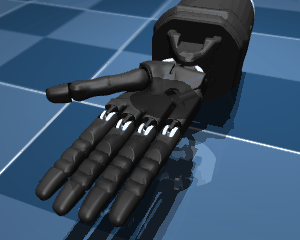
   </p>
   <p align="center"><sub>Stage 1: each actuator swept to the top and bottom of its range and back
   (real-time playback), then the object dropped into the open palm.</sub></p>

2. **Contact-face tooling + a stable one-ball hold -- DONE.** One 45mm / 80g ball
   (`assets/scene_one_ball.xml`).

   - **Classifier**: `hand_env.classify_contacts` labels every hand contact on a body by digit,
     segment and FACE -- palmar (pad), DORSAL (back), side, or tip (the very end of a distal
     segment) -- from the contact point's offset from the segment's own long axis, measured against
     `palmar_axis`. `eval_stage2_classifier.py` touches the ball to every flexion segment from known
     directions: 65/65 labelled correctly.
   - **Hold test**: the hand closes on the ball, then gravity is pointed in six directions -- palm
     up, palm DOWN, fingers up, fingers down, either side down (the same physics as turning a
     fixed-base hand over). Held = the ball moves under 1cm in the palm frame over 2s.
   - **Grasp search** (`search_stage2_grasp.py`, cross-entropy method over the 18 finger and thumb
     targets): holding turned out to be the easy part -- most random samples already held in all
     six directions, by caging the ball with fingertip ENDS and the sides of segments. The search
     only found real wraps once the score rewarded pad contacts specifically (and penalized
     fingertip ends), and only found ones that STAY wraps once those contact terms were averaged
     over 7 perturbed copies of each candidate: the first 4-pad grasp lost its pads to the
     4th-decimal rounding of its own targets.
   - **Result** (`hand_env.ONE_BALL_GRASP`, `eval_stage2_hold.py`): mf, rf and lf wrap the ball
     with the palmar faces of their proximal and distal segments. Held in all six directions
     (drift 0.5-1.9mm), peak effort 22% of the force limits; under 100 perturbed trials (every
     target +-0.05 rad, placement +-3mm, mass 40-150g, friction 0.5-1.0) held 100/100, three pads
     on the ball in 85, no dorsal contact in any.

   <p align="center">
     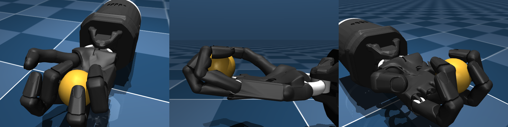
   </p>

   What it does NOT do: the thumb lies across the palm, off the ball, and the ball is wrapped up
   near the knuckles rather than sitting in the palm. Raising the thumb's weight in the score got
   the thumb on only as a 0.3N graze (`media/stage2_grasp_e_robust_light_thumb.png`); placing the
   ball mid-palm and holding it while the hand closes (it rolls off an open hand) gave grasps that
   held just as well but with a single pad. Left there deliberately: one 45mm ball in a palm built
   for two is a poor stand-in for baoding, where the two touching balls fill the palm's whole
   length and the thumb's job is pushing, not pinching. The earlier search rounds are kept as
   `media/stage2_grasp_{a,b,c}_*.png`.
3. **Two-ball bowl, reviewed as images -- DONE.** Two touching 45mm balls
   (`assets/scene_two_balls.xml`). The shape is the user's: *"all 5 finger point up and curl a
   little inside and make bowl shape with two balls sit in the palm"*, then *"tips of 5 fingers
   almost like in same height"*, then *"make 4 fingers separated more to make gap between fingers
   and thumb smaller on both side"*. Found by `search_stage3_bowl.py` (CEM over all 20 targets plus
   where the pair is placed; both balls are held in place while the hand closes, then released),
   each round restricted and scored toward that shape and reviewed as a render
   (`show_stage3_bowl.py`):

   | round | image | what it showed |
   |---|---|---|
   | cradle | `stage3_cradle_a.png` | thumb and little finger on the outsides, but mf/rf curled under the balls -- no bowl |
   | hand-set | `stage3_bowl_manual.png` | the finger shape, but a LEVEL palm is open at the wrist side: one ball rolled out. The wrist became part of the search; tilting the palm ~25 deg toward the fingers settles the balls into the cup |
   | a | `stage3_bowl_a.png` | fingers standing up, thumb sticking out sideways |
   | b | `stage3_bowl_b.png` | five tips at one height (8.2-9.0cm); tips bunched (5.7cm span) |
   | c | `stage3_bowl_c.png` | an "even gaps" term was GAMED: the thumb moved in across the palm, the finger span shrank |
   | d | `stage3_bowl_d.png` | fingers forced to their widest (9.4cm span): they lie down, the bowl opens, balls separate |
   | **e** | `stage3_bowl_e.png` | **chosen**: moderate fan (6.8cm span), tips 8.0-8.9cm, balls held + touching in all perturbed runs |

   Why the fingers can't fan much wider: a finger's spread joint (J4) swings it about the palm's
   normal, and a finger standing up lies ALONG that axis -- spreading just twists it (0.2 rad moves
   the tip <= 0.3cm). To move a tip sideways the finger must lean, and leaning also tips it forward,
   out of the bowl wall. `hand_env.BOWL_GRASP`: ~1.4 N total finger force, so the balls are cradled,
   not clamped -- free to roll, which is the point.

   <p align="center">
     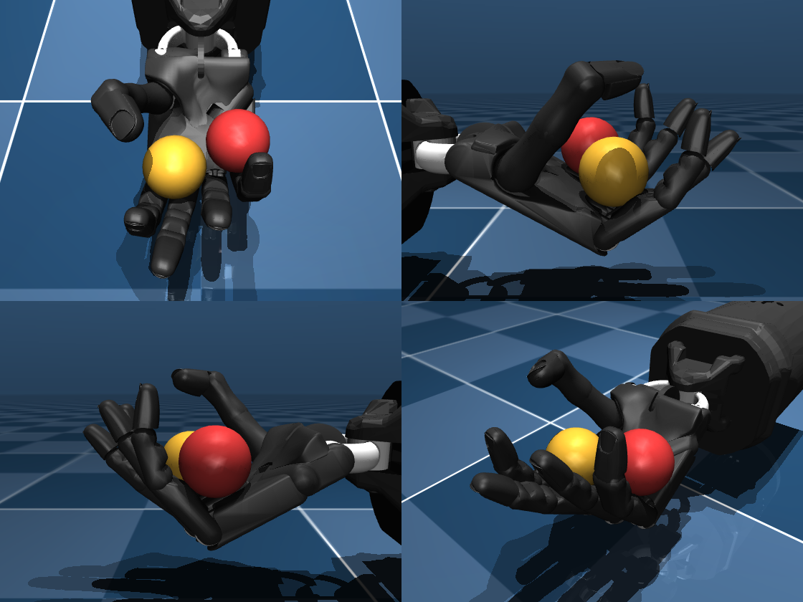
   </p>

4. **Scripted baoding -- tried, does not circulate (negative result).** All five digits take
   part -- the user: *"not only little finger and thumb, all fingers should involved as needed to
   make baoding trick"*. Judged on each ball's OWN cumulative angle around the pair's starting
   midpoint (`hand_env.BallAngles`, palm frame), the worse of the two balls, worst value over the
   last 2.5s of a 10s run -- a swap needs both past pi.

   - **Press wave** (`hand_env.BaodingWave`, `search_stage4_baoding.py`): every digit presses in
     and relaxes once per cycle, phases ordering the presses round the rim, plus a small wrist
     circle. The first search scored the angle at the final instant and found a wave that just
     rocks the jammed pair +-0.4 rad and ends on the top of a rock; with the worst-over-a-cycle
     score the best is 0.25 rad: rocking.
   - **Circular fingertip motion** (`hand_env.BaodingCircle`, `--controller circle`) -- the user,
     on the press-wave GIF: *"fingers maybe should make circular move to push balls cross each
     other"*. Each digit's two joints are driven a quarter-cycle apart so the tip traces a loop;
     plus the finger spread joints. Best after 20 CEM rounds: 0.10 rad -- still rocking.
   - **Why: the ideal-push test** (`hand_env.push_forces`): the hand holds the bowl still while a
     1 N tangential force on each ball drives them round the midpoint. In bowl e the gold ball
     stalls after ~1/4 turn either way -- against the ff/mf proximal segments (the knuckle row:
     upright fingers make a wall there) or the BACK of the thumb's proximal segment, which lies
     across the palm's thumb/wrist corner. Adding this test to the bowl search
     (`search_stage3_bowl.py --circulate`, worst of 4 perturbed pushes; the first two versions were
     gamed by angle gained before a drop and by one lucky run in a mean): from bowl e 0.27-0.57 rad;
     weighting circulation 10x (bowl shape mostly lost, fingers off the balls) ~1.4 rad; 40mm balls
     (`--ball-radius 0.02`) 1.31-1.47 rad. In every bowl the thumb's base joint THJ4 sits at its
     limit. Adding a centering spring to the push changes nothing.

   So no FIXED bowl lets the balls pass each other here, and no fixed periodic motion clears the
   way: baoding needs digits that move out of a ball's path as it arrives (the thumb lifting as the
   gold ball comes round) and push it from behind -- motion keyed to where the balls are. That is
   Stage 5.

   <p align="center">
     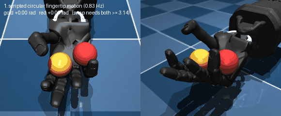
   </p>
   <p align="center"><sub>Stage 4: the best circular fingertip motion (8s, balls rock in place),
   then the bowl held still under the ideal 1 N push each way -- the gold ball jams after ~1/4
   turn. The press wave's version: `media/stage4_wave_and_push.gif`.</sub></p>
5. **RL baoding -- DONE: two 50mm balls swap ~10 times per 20 s, all five digits relaying.** PPO
   (stable-baselines3, 16 envs, ~1.5k steps/s), the wrist held still, only the 18 finger and thumb
   targets are actions. Progress = the LEAST of each ball's own arc round the pair's centre and the
   rotation of the line between them (both must go round together: rocking, one ball circling or
   jiggling earn nothing); a swap is pi.

   <p align="center">
     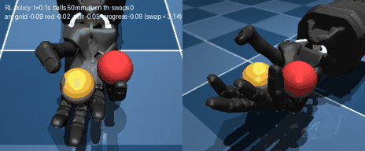
   </p>
   <p align="center"><sub>Stage 5 (baoding_15 @60M, 50mm balls, a bowl start): 12 swaps in 20 s,
   no drop, real-time playback. Pads face the balls, no back-of-finger contact, the balls stay on
   the palm.</sub></p>

   Fifteen runs; what each taught:

   | runs | env | what happened |
   |---|---|---|
   | 01 | `rl_env_baoding` | a per-step "matched angle" reward was GAMED by jiggling the balls at the centre -> progress as above |
   | 02-03 | same | ~1 swap then a deliberate drop (a flat drop cost makes swap-then-drop optimal); the little finger rolled its back to the balls |
   | 04-06 | same + style terms | per-joint caps, pad-facing, five-pad, relay-handoff, relay-clock, ball-on-palm rewards: by 06 it LOOKED right (pads on, relay order, balls on palm) at 0.38 rad per 20 s -- the style terms paid ~180/episode, a swap ~51. Lesson: positive reward ONLY for ball motion; shape is limits and penalties |
   | 07 | `BaodingEnv2` | reward rebuilt: finger credit = pad force along the orbit x the ball's forward speed, swap bonus 25, penalties for tips leaving the bowl, pads facing away, back-of-finger contact; ball-size curriculum 40->45mm. Capped at 0.36 rad = the ideal-push ceiling of the still bowl: in NO bowl does a pushed pair pass with the hand still, so the 1.5cm tip band forbade the swap |
   | 08-09 | `BaodingEnv2/3` | band 3.5cm, direction -1: 1.2 rad in 1 s then clamp -- one ball sunk in the thumb-base/wrist corner. A stall penalty didn't help; an open-loop trajectory search from that corner reached 0.04 rad: a physical wall |
   | 10 | `BaodingEnv4` | joint limits widened (flexion full range, tip band 6cm; the search then escaped the corner 2.31 rad). Passes the corner, but uncapped work credit paid for pushing HARDER, not further |
   | 11 | `BaodingEnv5` | work credit capped per rad of progress. Broke through at ~17M; by 30M the curriculum reached 44mm and bowl starts swap ~3x per 20 s |
   | 12 | `BaodingEnv6` | 50mm balls from scratch (the user: balls should *"completely occupy the as big as possible bowl shaped by five fingers"*): holds, but ~1.2 rad per 20 s at 30M, never a swap |
   | 13 | `BaodingEnv7` | **11 continued, the curriculum extended to 50mm**: 45->47->48->50mm by 33.8M, trained to 45M |
   | 14 | `BaodingEnv8` | fewer drops (below): 13 @44M continued to 54M |
   | **15** | `BaodingEnv9` | the work shared among the digits (below): 14 @52M continued to 62M |

   Evaluation (`--start-seed` 0-31: randomized start arrangement, ball mass, friction, target noise;
   50mm balls, 20 s, deterministic policy):

   | checkpoint | >= 1 swap | dropped | mean swaps, bowl starts / other starts |
   |---|---|---|---|
   | 13 @36M | 20/32 | 21/32 | 2.4 / 5.2 |
   | 13 @40M | 30/32 | 14/32 | 5.2 / 7.6 |
   | 13 @44M | 29/32 | 14/32 | 5.5 / 8.4 |
   | 13 @44M, `BaodingEnv8` rules | 31/32 | 6/32 | 9.1 / 7.9 |
   | 14 @52M | 30/32 | 4/32 | 10.3 / 9.4 |
   | **15 @60M** | **29/32** | **4/32** | **11.3 / 9.7** |

   Two of the last four drops are the only two "corner" starts among the 32 (one ball sunk in the
   thumb/wrist corner): from there the policy turns the balls backward and drops them.

   **The drops, examined**: of baoding_13's 14, three were starts that settled with a ball
   still rolling or the pair apart (over in < 0.2 s), and three were a 50mm ball touching the 6cm
   sideways limit (sized for 40-45mm balls) and staying in the hand -- with the limit lifted, those
   episodes went on to 9-10 swaps. `BaodingEnv8` (`--env 8`): 6.5cm limit, such starts redrawn, and
   a drop costs 10 per second left instead of 3 (it was cheap next to ~50 per second earned while
   swapping). The same 44M policy under it, untrained: **31/32 swap, 6/32 drop, 8.3 swaps per 20 s**
   (`eval_stage5_baoding.py`); baoding_14, trained on it: 4/32.

   **The work, shared** -- only partly. In baoding_14 the index finger did ~80% of the forward work
   on the balls; mf, rf, lf and the thumb mostly steered, and the thumb braked. `BaodingEnv9`
   (`--env 9`): each digit earns credit for at most 30% of the (unchanged) progress-bounded work cap.
   Forward work per digit, 12 randomized episodes:

   | checkpoint | ff | mf | rf | lf | th | swaps per 20 s |
   |---|---|---|---|---|---|---|
   | 14 @52M | 81% | 9% | 8% | 1% | 1% | 10.2 |
   | 15 @60M | 74% | 19% | 5% | 1% | 1% | 9.9 |

   The middle finger took a share; the little finger and thumb still don't push. Pushing past the
   30% earns nothing but costs nothing either, so the working motion stays. Stopped here.

   Every GIF along the way (`media/`, 2x slowed frame rate, real-time playback):

   | GIF | what it shows |
   |---|---|
   | `stage5_baoding_02_2M`, `_02_14M` | progress metric fixed after run 01's exploit; by 14M ~1 swap, then a deliberate drop |
   | `stage5_baoding_03_18M` | the little finger rolled over (LFJ5 + LFJ4 maxed), its back to the balls |
   | `stage5_baoding_04_4M`, `_10M`, `_final` | pad-facing caps: balls kept, but only ff and rf push, ~2.3 rad per 20 s |
   | `stage5_baoding_05_4M`, `_10M`, `_final` | relay-handoff bonus: handoffs happen, ff pushes backward, a ball rides up on the ring finger |
   | `stage5_baoding_06_4M`, `_final` | relay clock + ball-on-palm terms: looks right, 0.38 rad per 20 s, the wrist wobbles |
   | `stage5_baoding_07_4M` | motion-only reward, tight 1.5cm bowl: stuck at the still bowl's 0.36 rad ceiling |
   | `stage5_baoding_08_4M`, `_10M` | band 3.5cm: 1.2 rad in the first second, then a ball clamped in the thumb/wrist corner |
   | `stage5_baoding_09_16M` | + stall penalty: the same clamp |
   | `stage5_baoding_10_4M`, `_10M` | wider limits: passes the corner from some starts; from the bowl the balls rock |
   | `stage5_baoding_11_14M`, `_22M` | capped work credit, before and after the breakthrough (bowl start still < 2 rad) |
   | `stage5_baoding_11_22M_swap` | 11 @22M from a corner start: 3 swaps, th -> lf -> rf -> mf -> ff relay |
   | `stage5_baoding_11_30M` | 44mm balls, bowl start: 6 swaps |
   | `stage5_baoding_12_4M`, `_10M`, `_20M`, `_30M` | 50mm from scratch: learns to hold, never swaps |
   | `stage5_baoding_13_36M`, `_44M` | the curriculum reaches 50mm: 8 and 10 swaps in 20 s |
   | `stage5_baoding_14_52M` | fewer drops: 11 swaps |
   | **`stage5_baoding_15_60M`** | work shared: 12 swaps, ff 74% of the pushing |

   Training logs and arguments of every run: `logs/`.

   ```
   python3 train_stage5_baoding_rl.py --run-name baoding_11 --env 5 --direction -1 --timesteps 30000000
   python3 train_stage5_baoding_rl.py --run-name baoding_13 --env 7 --level 3 --direction -1 \
       --timesteps 15000000 --resume runs/baoding_11/checkpoints/ppo_30000000_steps.zip
   python3 train_stage5_baoding_rl.py --run-name baoding_14 --env 8 --level 6 --direction -1 \
       --timesteps 10000000 --resume runs/baoding_13/checkpoints/ppo_44000000_steps.zip
   python3 train_stage5_baoding_rl.py --run-name baoding_15 --env 9 --level 6 --direction -1 \
       --timesteps 10000000 --resume runs/baoding_14/checkpoints/ppo_52000000_steps.zip
   python3 eval_stage5_baoding.py runs/baoding_15/checkpoints/ppo_60000000_steps.zip --env 9 --n 32
   python3 demo_stage5_baoding_rl2.py runs/baoding_15/checkpoints/ppo_60000000_steps.zip --env 9 \
       --direction -1 --level 6 --start-seed 1 --record media/stage5_baoding_15_60M.gif
   ```
   (baoding_11 was trained 0-22M then resumed to 30M, its first part warm-started from baoding_10
   @10M; `--resume` adds `--timesteps` to the count.)

6. **Three-ball baoding -- RL DONE at the demo's own speed: 21 of 24 60 s tests keep all three balls,
   ~2 circles a minute, pads only.** (The planner demonstration it learned from: 2.3 circles.)
   Three touching 45mm balls (`assets/scene_three_balls.xml`), the wrist still, all fingers in a
   relay, the balls on the palm.

   <p align="center">
     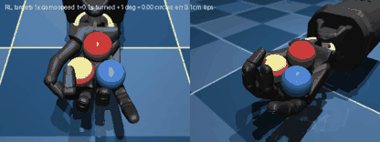
   </p>
   <p align="center"><sub>Stage 6 RL (track_10 @164M, targets at 1x, the pad demo's own speed), a 60 s
   test from demo step 135: the trio turns 738 deg (2.05 circles), 0.34cm off the demo, no ball lost,
   fingers only, no fingertip contact. Real-time playback. How it got here: steps 4-9 below.</sub></p>

   <p align="center">
     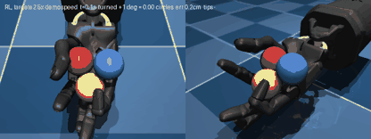
   </p>
   <p align="center"><sub>The fast version (track_08 @104M, 2.5x the demo's speed, 20/24 kept for
   60 s): 1733 deg (4.8 circles) from demo step 2823.</sub></p>


   <p align="center">
     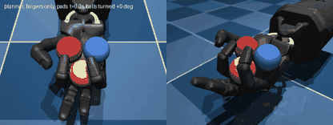
   </p>
   <p align="center"><sub>Stage 6: the sampling planner with a fingertip cost, one run from the
   start: the trio turns 825 deg (2.3 circles) in 71 s, no ball lost, fingers only, every finger
   pressing with its pads (fingertip contact 2% of the time, the little finger only). Real-time
   playback.</sub></p>

   **RL alone, the Stage 5 recipe (runs three_01-06, `rl_env_baoding3.py`, `--env 10-14`)** --
   stalls at a JAM: once per third of a turn one ball sinks into the palm heel between the thumb's
   base and the little finger's metacarpal. three_06 (to ~72M; a reverse curriculum of jam and
   passage starts, `collect_stage6_jam_states.py`) learned to HOLD in the jam (drops from jam starts
   13/16 -> 1/16) but not to pass it: best 2.6 rad in 90 s.

   **The rebuild, step by step** (the MyoChallenge baoding winner's recipe, Chiappa & Mathis 2024:
   each ball tracks a target moving round a circle; static holds first, then faster):
   1. *Is every placement holdable?* (`eval_stage6_circle_hold.py`): a CEM over the 18 finger
      targets per phase of the circle -- yes, every phase at every centre tried, drift <= 3mm.
   2. *Do the hold postures, blended, carry the balls?* (`eval_stage6_posture_sweep.py`): no -- a
      ball is lost in 1-22 s.
   3. *A planner on the MuJoCo model itself* (`stage6_teacher.py`, predictive sampling as in MuJoCo
      MPC): from the true state, a CEM over 5 finger waypoints for the next move, executed, re-planned.
      - small steps (15 deg, nearest-target): every run of 14 (38/45mm balls, 4 centres, both
        directions) stalls at <= 86 deg;
      - whole "clicks" with labeled targets (each ball to its own next place: the human tutorial's
        *"it's like going uphill and then they fall in place"*), polished balls (ball-ball friction
        0.15, `scene_three_balls_slick.xml`): ~300 deg, then a dead end; a closed-loop MPC
        (`stage6_mpc.py`) ~220 deg; a small wrist tilt did not help;
      - **+ backtracking** (`--backtracks`: when every plan loses a ball, back out one or two moves
        and search again): **605 deg**, and a continuation from its last settled moment 717 deg -- the
        first two circles. The user on it: *"ring finger and middle finger sometime use tip of the
        finger ... not very elegant"*: a fingertip on a ball 54% of the time for the little finger,
        22% the ring, 6% the middle;
      - **+ a fingertip cost** (`--tip-weight 3`: per finger, not the thumb, pressing a ball with its
        tip -- the rounded end cap, `hand_env.classify_contacts`): **825 deg in 71 s, one run, pads
        only** (the GIF above). 1 of 3 seeds; the others lost a ball at ~330 and ~565 deg.

   | demo | turn | time | fingertip contact (ff/mf/rf/lf) | file |
   |---|---|---|---|---|
   | backtracking, stitched | 717 deg | 98 s | 0% / 6% / 22% / 54% | `data/stage6_demo_two_circles.npz` |
   | **+ fingertip cost** | **825 deg** | **71 s** | **0% / 0% / 0% / 2%** | `data/stage6_demo_pads.npz` |

   The planner is not a controller: it searches ~120 simulated futures per move and rewinds on dead
   ends -- ~3.5 h of compute for 71 s of baoding, on a perfect copy of the world.

   4. *RL distilled from the demo* (`rl_env_track3.py`, `train_stage6_track.py`): PPO, each ball
      tracking a target, a fingertip penalty, starts at random demo moments, warm-started by behaviour
      cloning (alone it drops a ball in 1-9 s). Targets moving round the circle at a constant speed
      stalled the curriculum at 3 deg/s for 13M steps: the trio passes a jam in a hop, which a smooth
      target asks it to creep through. Targets following the demo's own timing (`--mode demo`,
      DeepMimic-style, played back faster as the curriculum): at 46M steps ~9% of 10 s episodes
      pass, a ball is lost in 3-33 s in 60 s runs. Paused.
   5. *The same on the pad demo* (`--demo data/stage6_demo_pads.npz`): **track_03** (behaviour
      cloning, then PPO, 40M steps) and track_04 (track_01 resumed, to 86M). For the first ~10M
      steps both only held the balls (60 s from the demo start: kept 56 s, turned -20 deg); then
      the pass rate climbed from ~10% to 40-50% and the curriculum moved on, track_03 to 5x the
      demo's speed, track_04 to 2.5x.

   <p align="center">
     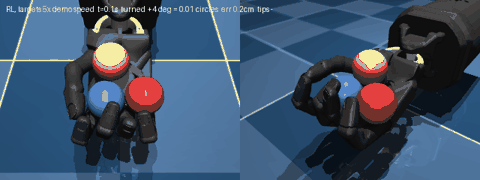
   </p>
   <p align="center"><sub>Stage 6 RL (track_03 @40M, targets at 5x the pad demo's speed): its best
   30 s run, from demo step 286: the trio turns 1021 deg (2.8 circles), no ball lost, fingers only,
   fingertip contact 1% of the time. Real-time playback.</sub></p>

   | policy | speed | episode | kept all balls | turn mean / max | fingertip rate |
   |---|---|---|---|---|---|
   | behaviour cloning alone | 1x | 10 s | 2/16 | 22 / 77 deg | 0.11 |
   | **track_03 @40M** | **5x** | **30 s** | **5/16** | **426 / 1021 deg** | **0.04** |
   | track_03 @40M | 5x | 10 s | 11/16 | 262 / 557 deg | 0.06 |
   | track_03 @40M | 1x | 10 s | 9/16 | 67 / 164 deg | 0.04 |
   | track_04 @86M | 2.5x | 10 s | 10/16 | 168 / 484 deg | 0.08 |
   | track_04 @86M | 1x | 10 s | 6/16 | 76 / 225 deg | 0.19 |

   Episodes start at random demo moments (16 per row, `eval_stage6_track.py`). The 5 kept 30 s runs
   turned 531-1021 deg (4 past two circles); the other 11 lost a ball, mostly in the first 30 s.
   The policy is good only at the speed it trained at: at 1x, 75 s from the demo's start, 312 deg
   and then a ball lost. Not yet reliable; training continues.
   6. *More training at a fixed speed* (`--threshold 0.95` keeps the curriculum at one level), both
      resumed from track_03 @40M: track_05 at 5x and **track_06 at 2.5x**, 12M steps each.

   <p align="center">
     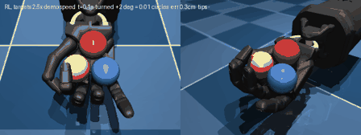
   </p>
   <p align="center"><sub>Stage 6 RL (track_06 @52M, targets at 2.5x the pad demo's speed), a 60 s
   test from demo step 135: the trio turns 1206 deg (3.35 circles) in 38 s, pads only, then one ball
   gets away (the end of the GIF). Real-time playback.</sub></p>

   | policy | speed | 30 s: kept | 30 s turn mean / max | 60 s: kept | 60 s max turn | err |
   |---|---|---|---|---|---|---|
   | track_03 @40M | 5x | 5/16 | 426 / 1021 deg | -- | -- | 2.81cm |
   | track_05 @52M | 5x | 8/16 | 494 / 1027 deg | 0/8 | 1061 deg | 2.57cm |
   | **track_06 @52M** | **2.5x** | **8/16** | **621 / 905 deg** | 0/8 | **1206 deg** | **1.25cm** |

   Balls lost per training episode fell from ~40% to 14% (track_05) and 6% (track_06), but every
   60 s test still loses a ball, mostly at 20-46 s: training episodes are 10 s, so the policy never
   learns to recover from the drift that builds up over a longer run.
   7. *Longer training episodes*: **track_07** = track_06 @52M resumed with 30 s episodes
      (`--episode-seconds 30`), next to track_06 still on 10 s episodes; 12M steps each.

   | policy | training episodes | 30 s: kept | 60 s: kept | 60 s turn mean / max | err |
   |---|---|---|---|---|---|
   | track_06 @64M | 10 s | 6/16 | 0/8 | 625 / 1283 deg | 1.54cm |
   | **track_07 @64M** | **30 s** | **11/16** | **4/8** | **1162 / 1818 deg** | **1.36cm** |

   The four kept 60 s runs turned 1396-1818 deg (3.9-5 circles); a fifth lost a ball at 59.6 s after
   1690 deg. Still failing: starts near demo steps 1686-1704 drop a ball within 1.6 s for both policies
   (the same hard moment, not chance), and one run lost a ball at 45 s. All at 2.5x the demo's speed.
   8. *Failure-focused starts* (`--hard-frac 0.5`, `DemoTrackEnv(hard_frac)`): half the resets start
      near a remembered ball loss -- each env keeps the demo moment of its drops (restart from the demo
      1-3 s of env time before it) and the policy's own state ~2 s before (restart there: practise
      recovering from that very slip). **track_08** = track_07 @64M with this and 60 s episodes, 40M steps.

   | policy | 60 s kept: seed 200 / 300 / 400 | total | err |
   |---|---|---|---|
   | track_07 @64M | 4/8, 3/8, 6/8 | 13/24 | 1.4cm |
   | track_08 @76M | 2/8, 4/8, 7/8 | 13/24 | 1.3cm |
   | **track_08 @104M** | **5/8, 7/8, 8/8** | **20/24** | **1.1cm** |

   The same 24 starts for every row; no gain after 12M steps, then a clear one by 40M. Of the 4 left,
   2 start at demo steps 1686 and 1704, which no policy can survive: replaying the demo's *own*
   controls open-loop from those saved frames loses a ball in ~1 s (`eval_stage6_demo_replay.py`: a
   saved frame does not resume the planner's run exactly, ~2mm per step, and the planner made one ball
   hop there, a knife-edge move; 19 of 347 frames fail this way, mostly 1660-1750). A re-plan from demo
   step 1500 (`data/stage6_demo_pads_hopfix.npz`, 733 deg in 55.6 s) removes that hop; training on it
   (track_09) did not pay off -- see step 9. A loss rule that ignores the demo's own 2-step, 0.5mm spread excursion at
   step 1755 (`--lost-hold 10`) gave the same scores, so the drops are real ones.
   9. *Each policy knows its one demo, at its one speed.* track_09 (track_08 @104M, 40M steps on the
      re-planned demo): 13/24 on it, and 0/24 back on the original (track_08 on the re-planned demo:
      4/24, drops right after its loop seam). So the original demo stays, and the speed comes down
      instead: **track_10** = track_08 @104M, `--down` (the curriculum steps 2x -> 1.5x -> 1.25x -> 1x,
      a level per 70% passes; it reached 1x in 4M steps), 60 s episodes, `--hard-frac 0.5`, 60M steps.

   | policy | 60 s at 1x: seed 200 / 300 / 400 | total | at 2.5x |
   |---|---|---|---|
   | track_08 @104M | 0/8, 0/8, 0/8 | 0/24 | 20/24 |
   | track_10 @132M | 6/8, 4/8, 7/8 | 17/24 | 0/24 |
   | **track_10 @164M** | **7/8, 6/8, 8/8** | **21/24** | -- |

   The kept runs at 164M turn 586-763 deg a minute (the demo itself: ~700), 0.27-0.61cm off it,
   fingertip contact 0-3%. One of the 21 only holds (start 1940: 392 deg, 2.8cm behind), so 20/24
   strictly. Lost: start 1686 (the planner's knife-edge hop, step 8) and starts 2656/2686 (a stall, then
   a drop at ~7 s). Start 1704, failed by every earlier policy, now keeps all three (743 deg). The fast
   skill is gone (0/24 at 2.5x): one policy, one speed. Next: several planner demos, so it learns
   baoding rather than one recording.

   ```
   python3 eval_stage6_circle_hold.py --scene assets/scene_three_balls_slick.xml --save data/stage6_circle_hold_slick.npz
   python3 stage6_teacher.py --scene assets/scene_three_balls_slick.xml --table data/stage6_circle_hold_slick.npz \
       --center 0.1,6.5 --labeled --step 60 --degrees 800 --waypoints 5 --seg 0.3 --hold 0.6 --pop 120 --iters 10 \
       --max-boost 4 --retries 1 --backtracks 12 --procs 5 --seed 0 --tip-weight 3 --out data/stage6_demo_pads.npz
   python3 train_stage6_track.py --run-name track_01 --bc --n-envs 8 --timesteps 40000000
   python3 train_stage6_track.py --run-name track_01 --mode demo --n-envs 15 --level 0 \
       --resume runs/track_01/checkpoints/ppo_24000000_steps.zip
   python3 eval_stage6_track.py runs/track_01/checkpoints/ppo_45999945_steps.zip --mode demo --seconds 60 --n 6
   python3 train_stage6_track.py --run-name track_03 --mode demo --demo data/stage6_demo_pads.npz --bc \
       --n-envs 8 --timesteps 40000000
   python3 eval_stage6_track.py runs/track_03/checkpoints/ppo_40000000_steps.zip --mode demo \
       --demo data/stage6_demo_pads.npz --rate-level 7 --seconds 30 --n 16
   python3 train_stage6_track.py --run-name track_06 --mode demo --demo data/stage6_demo_pads.npz --n-envs 8 \
       --timesteps 40000000 --threshold 0.95 --level 4 --resume runs/track_03/checkpoints/ppo_40000000_steps.zip
   python3 train_stage6_track.py --run-name track_07 --mode demo --demo data/stage6_demo_pads.npz --n-envs 8 \
       --timesteps 40000000 --threshold 0.95 --level 4 --episode-seconds 30 \
       --resume runs/track_06/checkpoints/ppo_52000000_steps.zip
   python3 eval_stage6_track.py runs/track_07/checkpoints/ppo_64000000_steps.zip --mode demo \
       --demo data/stage6_demo_pads.npz --rate-level 4 --seconds 60 --n 8 --seed 200
   python3 train_stage6_track.py --run-name track_08 --mode demo --demo data/stage6_demo_pads.npz --n-envs 8 \
       --timesteps 40000000 --threshold 0.95 --level 4 --episode-seconds 60 --hard-frac 0.5 \
       --resume runs/track_07/checkpoints/ppo_64000000_steps.zip
   python3 eval_stage6_track.py runs/track_08/checkpoints/ppo_104000000_steps.zip --mode demo \
       --demo data/stage6_demo_pads.npz --rate-level 4 --seconds 60 --n 8 --seed 200   # also 300, 400
   python3 eval_stage6_demo_replay.py data/stage6_demo_pads.npz --seconds 2 --every 10
   python3 train_stage6_track.py --run-name track_10 --mode demo --demo data/stage6_demo_pads.npz --n-envs 15 \
       --timesteps 60000000 --threshold 0.7 --level 3 --down --episode-seconds 60 --hard-frac 0.5 \
       --resume runs/track_08/checkpoints/ppo_104000000_steps.zip
   python3 eval_stage6_track.py runs/track_10/checkpoints/ppo_163999850_steps.zip --mode demo \
       --demo data/stage6_demo_pads.npz --rate-level 0 --seconds 60 --n 8 --seed 200   # also 300, 400
   ```

   **What kind of learning this is.** Motion imitation by RL (DeepMimic-style tracking), not classic
   imitation learning: the demo supplies *states* -- each ball's target at every moment (the reward and
   part of the observation), the start states, and the loop for long runs -- while its *actions* are used
   only once, for the behaviour-cloning warm start. PPO finds its own finger motions: cloning alone kept
   the balls 1 time in 12 for 10 s, and from demo step 1704 the policy survives where replaying the
   demo's own controls loses a ball. The price is imitation's usual one: the goal is "be where the demo's
   balls are", so the policy is tied to one recording, one speed and one direction.

   **Next option on this path (not started): several planner demos (option 3).** Planner runs with new
   seeds, both directions (`stage6_teacher.py --sign -1`), the same pad settings; keep the ones that go
   the distance (~1 in 3 seeds did) and pass `eval_stage6_demo_replay.py`; train one policy on all of
   them (`DemoTrackEnv` picking a demo per episode, the demo's direction in the observation), warm-started
   from track_10. Expected: both directions; more ways back after a slip (several valid paths through
   each pass); weak spots of one demo covered by another; the real test, a held-out demo, above the 0/24
   that single-demo policies score on a demo they never saw -- with per-demo scores perhaps a little
   below 21/24 at first. Cost ~2-3 days (8-10 planner runs of ~4 h, then training). It is still demo
   tracking: free baoding with no reference path is a further step (the reward-only Stage 5 recipe
   stalled at the jam, runs three_01-06).

7. **Two hands, four balls -- B DONE: each hand turns its own pair; A (one loop across both palms): four
   balls round one loop DONE (they follow each other; no crossing yet); the crossing figure-8: one ball
   DONE (12 laps in 30 s, 80/80 kept), two balls DONE (80/80 kept, ~5.5 laps each), three
   DONE (80/80 kept, ~3.5 laps each), four DONE as a clump: all kept and every ball
   crossing (78/80) but bunched and slow (~1.3 laps); spreading them out (a timetable) in progress -- a finger-wave loop across both cupped hands laps one ball every ~2 s and TWO balls
   together ~12.5 laps in 30 s each, FOUR balls ~9.5 laps in 30 s each with a ball dropped in a third of
   30 s runs, then with the wrists flexed back 0.05 and 30 s training episodes 49/50 kept at ~10 laps
   each (RL wave4_05 @52M).** Two-hand four-ball patterns found on YouTube: (A) [spheres108, "4 Baoding Balls"](https://www.youtube.com/watch?v=iyMXsvBwHKQ)
   -- palms up side by side, four balls kept apart in ONE loop across both palms, crossing where they
   meet; (B) [Curtis Zimmerman, "How to roll 2 balls in both hands"](https://www.youtube.com/watch?v=OrymhfihtS4)
   -- two-ball baoding in each hand at once; (C) [spheres108, "Passing 4 baoding balls"](https://www.youtube.com/watch?v=UXAFp3tYJBE)
   -- four balls in one hand, passed as a group (needs four in one hand: not attempted). Plan: B, then A.

   <p align="center">
     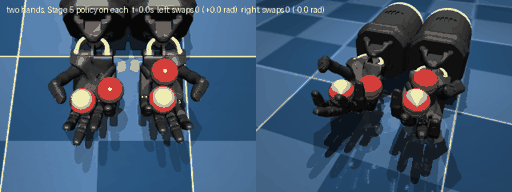
   </p>
   <p align="center"><sub>Stage 7B: a right and a (mirrored) left Shadow Hand, palms up side by side, two
   50mm balls each, both driven by the Stage 5 policy (baoding_15 @60M) in one simulation: 11 swaps
   per hand in 20 s, no drop; the left pair turns the mirrored way. Real-time playback.</sub></p>

   - *The scene* (`two_hands.py`): the Stage 5 scene plus the menagerie left hand (`assets/left_hand.xml`,
     vendored unmodified) attached with MjSpec under the prefix `L_` (the two hand files name their meshes
     after the same .obj files, so they cannot just be included together), 13cm along the right palm's -x,
     little fingers facing. The menagerie left hand is the right one mirrored in palm x with joint axes
     flipped where needed: the same joint angles give the mirrored pose (checked: 0.000mm over random
     poses).
   - *One policy, both hands, no retraining* (`stage7_two_hands.py`): each hand has a proxy -- a
     single-hand Stage 5 env that never steps physics; every control step the hand's joints and its
     two balls are copied into it (the left hand's through the palm-x mirror) and its own bookkeeping
     (relay clock, ball tracker, drop limits) runs on the copy, so the policy sees exactly its training
     observation (checked: a round trip reproduces the observation exactly, both hands). Its action goes
     back to that hand's actuators.
   - *A trap*: the policy first failed in the two-hand scene (dropped in 2-10 s) because the scene
     compiled the balls at 50mm, while the Stage 5 env compiles them at 45mm/80g and resizes them at run
     time without `mj_setConst` -- MuJoCo's compile-time solver constants (`invweight0`) differed, and a
     replay of the same actions diverged from the first step. Compiled like Stage 5: within ~2mm over 5 s
     open-loop, and the closed loop below.

   | 8 episodes x 20 s | both hands kept | left kept / swaps | right kept / swaps |
   |---|---|---|---|
   | two-hand scene | **7/8** | 8/8, 11.8 | 7/8, 11.2 |
   | (Stage 5 alone, 32 episodes) | -- | -- | 28/32, 10.3 |

   ```
   python3 two_hands.py                       # build, mirror check
   python3 stage7_two_hands.py runs/baoding_15/checkpoints/ppo_60000000_steps.zip --n 8 --seconds 20
   python3 stage7_two_hands.py runs/baoding_15/checkpoints/ppo_60000000_steps.zip --n 1 --gif media_full/stage7_two_hands_B.gif
   ```

   **7A: four balls in one loop across both palms (in progress).** Of two forms -- (1) the four balls
   packed as a 2x2 square across the seam, the square turning so that each ball crosses from one hand to
   the other every half turn, or (2) the balls spaced round a loop as in the video -- (1) first, (2) the
   fallback. Both stalled; the way that works so far is the long cup with a finger wave (below).

   <p align="center">
     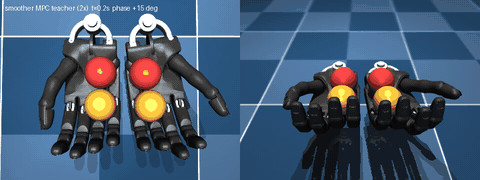
   </p>
   <p align="center"><sub>Stage 7A: the planner demo -- one full counter-clockwise turn (364 deg) of the
   packed square in 106 s, every ball crossing the seam twice, no ball lost. Top and oblique views, 2x
   playback.</sub></p>

   - *The layout* (`stage7_layout.py`): palms up, little-finger edges touching (gap 8.3cm; the forearm
     geoms are left out with `two_hands.build(forearms=False)` -- the forearms are wider than the palms and
     welded to the world, so they only overlap visually). Four 45mm balls placed on a ring at the seam roll
     into a packed 2x2 square there on their own.
   - *The teacher* (`stage7_teacher.py`): the Stage 6 segment planner (CEM sampling MPC, backtracking)
     on both hands, 40 actuators, each ball aimed at its own corner of the square turned on 15 deg a
     segment. Fingers alone stall at 45 deg, the "diamond": the palms slope ~2cm toward the fingers, the
     trailing ball sits by the palm heels where no finger reaches, and levelling the palms rolls the balls
     further back. What works: curled fingers (J3 0.7, J0 1.0) and the wrists free by +-10-15 deg --
     tilting the palms rolls the balls, the key move.
   - *A smoother demo.* The first full turn (`data/stage7_demo_ccw360.npz`, 112 s) had the fingers and
     thumbs flailing and a hold-then-hop rhythm. A soft cost on posture only made the planner hold still
     (a 15 deg turn gains less than moving costs); a hard band does it: every finger/thumb actuator kept
     within 25% of its range of the posture (`--band 0.25`). Every band run stalled at 238-256 deg (even a
     60% band) until the wrists got +-15 deg -- that stretch needs wrist travel, not fingers. The demo is
     three resumed runs stitched into one continuous recording (`--resume` keeps the log): 0-183 deg band
     25%/wrists 10 deg, 183-274 deg band 35%/15 deg, 274-364 deg band 25%/15 deg.

   | demo (`demo_stats.py`) | length | finger posture deviation (mean / max) | turn per 1 s (median / p90) | 1 s windows turning < 1 deg | finger ctrl change per step |
   |---|---|---|---|---|---|
   | first (`stage7_demo_ccw360`) | 112 s | 11.5 / 14.1 | 0.3 / 11.4 deg | 57% | 0.105 rad |
   | **smooth** (`stage7_demo_smooth360`) | 106 s | **6.7 / 9.3** | **2.3 / 8.2 deg** | **30%** | 0.094 rad |

   (Posture deviation: the sum over the 36 finger/thumb actuators of |u - posture| / range.) The fingers
   stay about twice as close to the posture and the turning is steadier; the per-step jitter (the CEM's
   sampling noise) is about the same, only in a smaller range.

   - *RL tracking* (`rl_env_stage7.py`, `train_stage6_track.py --mode two`): the Stage 6 recipe on the
     two-hand scene -- each ball tracks its own position in the demo (reward exp(-cm/1.5), lost ball -20),
     the observation shows the targets now and 0.5 s ahead, starts are random demo moments, a speed
     curriculum (1x-10x), 30% failure-focused starts, a behaviour-cloning warm start. Exploration noise
     starts lower than in Stage 6 (log std -1.5): with 40 actuators, the demo's own controls plus noise
     of std 0.37 drop a ball in ~3 s. Cloning alone drops a ball in 1-2 s.
     Run two_01 (10 s episodes) reached 2x by 11M, 2.5x by 18M; tested at 1x over 30 s (24 starts,
     `eval_stage7_track.py`) its best checkpoint, 14M, keeps all four balls **18/24**, but turns only
     ~30 deg in the 30 s (the demo: ~100 deg) -- it holds more than it spins so far. 30 s episodes at 2x
     (two_02) failed: the targets run away from the policy and the reward vanishes. two_03 (30 s
     episodes from 1x) is the best so far: **20/24 kept, ~38 deg turned** in 30 s at its 22M checkpoint.
   - *Where it fails: the hand-off.* The policy tracks for 5-10 s, then stalls just past the square's
     aligned poses (~90, 180, 270, 360 deg -- the hand-off across the seam) while the targets run on; at
     4-5cm behind, exp(-error) leaves nothing pulling it on. Five fixes, all scored by the same 24 strict
     30 s tests at 1x, none beat two_03 @22M:

   | run (resumed from two_03 @22M unless noted) | change | best result (kept / turned) |
   |---|---|---|
   | two_03 (longer) | nothing: 26M | 19/24, 29 deg |
   | two_05 | a *waiting target*: its clock runs only while it leads the balls by < `--lead-deg` | 21/24, 25 deg (idles: waits ~50% of the time) |
   | two_06 | the waiting target + a reward for turning (`--w-prog`) | 13/24, 40 deg (gambles) |
   | two_07 | *stall-focused starts* (`--stall-starts`): stalls (< 3 deg in 5 s), not only losses, become restart points, the target re-aligned to the balls | 20/24, 28 deg (stalled more: 73% -> 95% of episodes) |
   | two_08 | *planner fixes* (DAgger-style, below): 30% of starts from a fix + BC on the fixes after each rollout | collapsed (lost 17% -> 80-100% after the first BC step) |
   | two_08b | fix starts only | 22/24, 31 deg (or 15/24, 38 deg) |
   | two_08c | fix starts + BC mixed with the demo's pairs at lr 1e-5 | 21/24, 16 deg |

   - *Planner fixes* (`stage7_stalls.py`, `rl_env_stage7.py` `fixes`): 40 states where two_03 @22M
     stalls were saved and the planner re-run from each (`stage7_teacher.py --resume <stall> --resume-at 0
     --degrees 30`, the wrists +-15 deg, no finger band -- the policy's fingers are outside the demo's).
     It recovers from most: of 28 tried (15 min each at most), 24 turned 20-35 deg with no loss -- so the
     hand-off *is* possible from where the policy sticks. A fix episode tracks the fix's balls, then the
     demo on from the matching turn (replaying the fix's own controls tracks it to 0.02cm). But neither
     restarting there nor cloning the fixes helped: BC on the fixes alone wrecks the policy (offline, 20
     minibatches at lr 1e-4 take two_03 @22M from 20/24 to 10/24); mixed with the demo at lr 1e-5 it is
     safe but the policy turns half as much. The packed square's hand-off stays the wall, so next is the
     fallback, form (2): the balls spaced round a loop.

   <p align="center">
     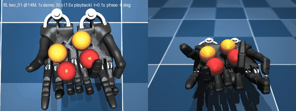
   </p>
   <p align="center"><sub>Stage 7A RL (two_01 @14M) at 1x demo speed: all four balls kept for 30 s,
   +68 deg turned (the best of 8). 1.5x playback.</sub></p>

   ```
   python3 stage7_layout.py --out media_full/stage7_layout.png
   python3 stage7_teacher.py --help                       # the demo's settings: see its docstring
   python3 demo_stats.py data/stage7_demo_ccw360.npz data/stage7_demo_smooth360.npz
   python3 render_stage7.py data/stage7_demo_smooth360.npz media_full/stage7_teacher_smooth360.gif --every 4 --speed 2
   python3 train_stage6_track.py --run-name two_01 --mode two --bc --hard-frac 0.3 --log-std -1.5 --timesteps 100000000
   python3 eval_stage7_track.py runs/two_01/checkpoints/ppo_13999965_steps.zip --level 0 --seconds 30 --n 8 --seed 200  # also --n 16 --seed 300
   python3 train_stage6_track.py --run-name two_07 --mode two --resume runs/two_03/checkpoints/ppo_21999945_steps.zip --episode-seconds 30 --hard-frac 0.3 --stall-starts
   python3 stage7_stalls.py runs/two_03/checkpoints/ppo_21999945_steps.zip --n 40 --out data/stalls
   python3 stage7_teacher.py --resume data/stalls/stall_003.npz --resume-at 0 --posture '<CURL json>' --wrist-tilt 15 --degrees 30 --backtracks 6 --out data/fixes/fix_003.npz
   python3 train_stage6_track.py --run-name two_08b --mode two --resume runs/two_03/checkpoints/ppo_21999945_steps.zip --episode-seconds 30 --hard-frac 0.3 --fixes data/fixes --fix-frac 0.3  # + --bc-aux 20 [--bc-aux-lr 1e-5 --bc-aux-demo]
   ```

   **7A form (2): the balls spaced round a loop on open palms.** 38mm balls, two per palm on a 4.5cm
   ring over the seam, fingers near open, the wrists +-25 deg and a forearm roll joint per hand (+-20 deg)
   that tilts the palms toward each other. Every way of driving it crept, held still, or dropped:

   | approach | script | result |
   |---|---|---|
   | segment planner on the spaced loop | `stage7_teacher.py` (`logs/stage7_spaced_*`) | best 252 deg in ~90 min of planning, then every plan loses a ball |
   | receding-horizon sampling MPC | `stage7_mpc.py` | ~32 deg in 38 s (0.9 deg/s) |
   | a fixed periodic rhythm, CEM over all actuators | `stage7_rhythm.py` | kept for 8 s turning 2-23 deg; lost later |
   | a hand-designed crossing cycle (flex + roll waves), CEM | `stage7_cross.py` | found holding still (5 deg) |
   | RL, momentum reward, no demo | `rl_env_stage7_loop.py`, `train_stage7_loop.py` (loop_01-05) | 25-35 deg per episode |
   | RL tracking the planner's spaced demo + a speed curriculum | `train_stage7_loop.py --track` (track_l1-l3) | track_l3 @16M: 8/8 kept 30 s at 1x, but 33-40 deg for the slowest ball; at 40M it drops at 2x |

   <p align="center">
     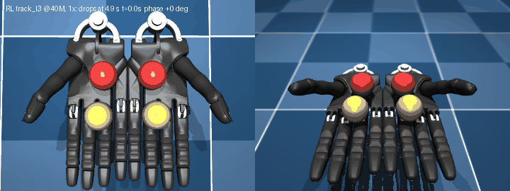
   </p>
   <p align="center"><sub>Stage 7A form (2), RL track_l3 @40M at 1x: the balls are kept, but they never
   really circulate -- the hands contort and drag the four along a little.</sub></p>

   - *Why it is hard with open palms*: a palm's tilt moves both of its balls the same way, so tilting can
     only steer each pair's centroid; turning the pairs takes fingers or walls. The finger-root crease traps
     the top balls, and with each palm rolling on its own axis the seam between the palms becomes a step
     the balls cannot cross (fixed with `two_hands.build(roll_at="seam")`: both roll hinges on one axis
     along the seam, so the two palms tilt as one rigid surface).

   **7A, the long cup** (`stage7_cup.py`). Both hands cupped into one long bowl -- curled fingers the wall
   at the finger end, the thumbs the far ends, the rolls on the seam axis -- holds all four balls under
   8-16 deg tilts, and balls cross the seam at 12 deg. A circular tilt of the whole cup (a "swirl", wine
   round a glass) leaves the top balls stuck (2-14 deg in 15 s, over 32 cup shapes and 45/50mm balls); a
   knuckle flick once a circle frees them but churns the balls through the middle (85/384 settings keep
   all four for 15 s). RL as a residual on the swirl + flick (`rl_env_stage7_cup.py`, cup_01, 17.5M) keeps
   the balls (10/10 for 10 s, vs 7/10 for the rhythm alone) but learns to park them: in 30 s from rest all
   four slide onto the left palm by 3 s and stay; the fingers never touch them.

   <p align="center">
     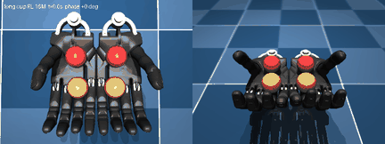
   </p>
   <p align="center"><sub>The long cup, RL cup_01 @16M: the balls settle on one palm and stay -- the
   flicking fingers never reach them.</sub></p>

   **7A, the finger wave: fingers as the drive.** With the fingers flat the eight fingers of the two hands
   make one row across the cup, ~2.2cm apart; a 38mm ball resting on them spans two. A wave of knuckle lifts
   runs along the row (`stage7_wave.py`): the finger behind the ball rises, the one ahead stays flat, and the
   ball rolls onto it -- a peristaltic conveyor. Flat fingers do not block a ball rolling over them, and the
   ball crosses the seam without a hitch. 49 of 216 settings carry one ball the whole row (~15cm), the
   fastest in 0.62 s; all the best need the wrists flexed (-0.1: the palms' heels high, the ball leaning
   on the fingers).

   <p align="center">
     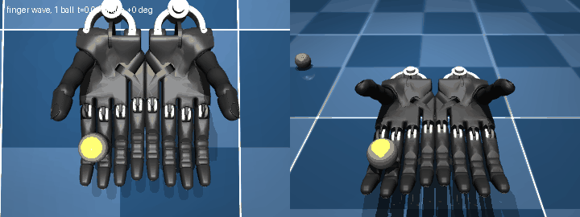
   </p>
   <p align="center"><sub>The finger wave carries one ball the length of the finger row, across both
   hands (half speed).</sub></p>

   - *A loop, scripted* (`stage7_wave_loop.py`): out along the finger row on the wave, back along the
     palms by tilting the cup. The way back fails: the ball ends in the hollow at the left thumb's base.
     The curled index fingers as end walls stop it falling off the row's ends; feedback tilts on the
     ball's place (`--fsm`), a lowered thumb, and a thumb sweep (the thumb lifts the ball rather than
     pushing it -- it rests ON the thumb's base) reach at best 1.3 laps in 15 s, usually 0.3.
   - *RL on the script, one ball* (`rl_env_stage7_wave.py`, `train_stage7_cup.py --env wave`): a residual
     on the scripted loop (wave, walls, thumbs 0.3, feedback tilts) on every joint (fingers and thumbs
     +-0.5 rad, wrists and rolls +-0.15), paid for the ball's turn round the loop centre (full pay at
     180 deg/s, nothing within 2cm of the centre), -50 for a drop. A bug first: the reset let the ball
     settle 0.5 s on bare flat fingers and in 15/40 starts it rolled out past the loss radius before the
     first action -- fixed (the settle runs the script; the fingertips count as on the hands), and the run
     resumed from 4M as wave_02.

   | one ball, deterministic policy | kept (10 s, random starts) | laps per 10 s |
   |---|---|---|
   | the script alone | 4/10 | -- |
   | wave_01 @4M | 10/10 | 0.1-1.0 (with exploration noise: 1.6-2.7, 7/10 kept) |
   | wave_02 @8M | 10/10 | 0.3-4.1 |
   | **wave_02 @24M** | **20/20** | **4.8-5.2** |

   From rest, wave_02 @24M laps the ball **14.9 times in 30 s** (179 deg/s, a lap every 2 s): along the
   finger row on the wave, up over the left thumb's base where the script stuck, back along the palms,
   down onto the row again. It is at the reward's full-pay speed.

   <p align="center">
     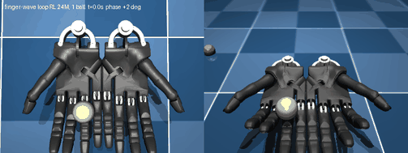
   </p>
   <p align="center"><sub>Stage 7A finger-wave loop, RL wave_02 @24M: one ball round the loop across both
   hands, a lap every ~2 s (the first 10 s of 30, ball kept throughout).</sub></p>

   - *Two balls* (`rl_env_stage7_wave.MultiWaveEnv`, `--n-balls 2`): the two balls start half a lap apart
     (a random point on the loop, 3mm jitter), so one is on the finger row while the other comes back
     along the palms. The one-ball script's tilt switched on where the ball was; the two balls need
     opposite tilts at once, so the base tilt is fixed halfway (flex 0, roll 0.05) and the policy steers
     it (+-0.15). Wave and walls as before. Reward: half the mean and half the slower ball's turn (full
     pay at 180 deg/s), a small penalty inside 1cm of each other, -50 for a drop. A fresh network
     (wave2_01). The base alone never drops a ball but barely turns them (-37..+109 deg per 10 s).

   | two balls, wave2_01 | kept (30 s, 10 random starts) | slower ball, laps per 30 s |
   |---|---|---|
   | @8M (10 s runs) | det 5/10, with exploration noise 10/10 | 0.0-0.7 / 0.1-1.4 per 10 s |
   | @12M | with exploration noise 4/10 | ~8.5 (when kept) |
   | **@18M, deterministic** | **10/10, and 10/10 on 10 fresh starts** | **11.3-12.9** |

   wave2_01 @18M keeps both balls going round together, each about **12.5 laps in 30 s** (~145 deg/s,
   within a few % of each other): about 15% slower per ball than one ball alone. Stopped at 20.7M.

   <p align="center">
     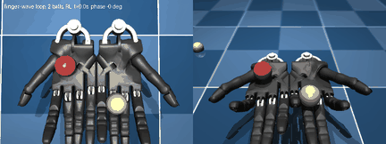
   </p>
   <p align="center"><sub>Stage 7A finger-wave loop, RL wave2_01 @18M: two balls half a lap apart round
   the loop across both hands (the first 10 s of 30, both kept, 13.5 laps for the slower ball).</sub></p>

   - *Four balls* (`--n-balls 4`, wave4_01, 40M, a fresh network): the balls start a quarter lap apart
     (~9cm); everything else as for two. The base alone holds all four (20/20) but turns none.

   | four balls, wave4_01, deterministic | kept (30 s, random starts) | slowest ball, laps per 30 s |
   |---|---|---|
   | @18M | 7/10 | ~5 |
   | @34M | 6/10 | 6.5-8.8 |
   | **@40M** | **8/10 on two sets of 10; 27/40 over 40 starts** | **8.4-10.0** (~110 deg/s per ball) |

   All four balls go round together, ~9.5 laps in 30 s each. A third of 30 s runs still drop a ball,
   and every drop is the same: a ball rolls off the heel of the palms at the seam between the hands,
   toward the wrists, at any time in the run. Training on did not close it (drops ~30% at 6M, ~20% at
   40M in training).

   <p align="center">
     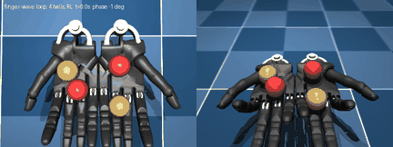
   </p>
   <p align="center"><sub>Stage 7A finger-wave loop, RL wave4_01 @40M: four balls round the loop across
   both hands (the first 10 s of 30, all kept, 10.1 laps for the slowest ball).</sub></p>

   - *Closing the drops.* Two reward penalties first, each resumed from the run before: wave4_02 (from
     40M) paid for a ball nearing the palms' heel (x 25 -> 23.5cm); wave4_03 (from 46M) also for a ball below
     x 30cm moving wristward faster than 10cm/s (dropped balls come down the palm leg at 10-24cm/s, kept
     ones rarely past 10-15). Neither closed it: training kept buying speed instead. Then the script:
     the 50M policy on variants of the base (wrist flex, the left wall, the wave's last lift).

   | four balls, deterministic, 30 s, 40 starts | kept | slowest ball, laps per 30 s |
   |---|---|---|
   | wave4_01 @40M | 27/40 | ~9.5 |
   | wave4_02 @44M (+ heel penalty) | 30/40 | ~10 |
   | wave4_03 @50M (+ wristward-speed penalty) | 31/40 | 10.4 |
   | wave4_03 @56M | 25/40 | ~11 |
   | @50M, base wrist flex +0.05 / +0.1 | 4/40 / 2/40 | 8.4 / 2.7 |
   | @50M, left index wall 0.4 (from 0.8) | 26/40 | 8.2 |
   | @50M, wave lift on the left MF x0.5 / x0 | 27/40 / 30/40 | 10.1 / 9.3 |
   | **@50M, base wrist flex -0.05** | **39/40 (and 8/10 on 10 fresh starts: 47/50)** | **8.5** |
   | @50M, base wrist flex -0.1 | 36/40 | 5.3 |

   Flexing the wrists back 0.05 rad lifts the palms' heel, and with it the drops all but stop -- with
   a policy never trained on it, for ~20% of the speed (~105 deg/s per ball). Fine-tuning on it
   (wave4_04, from 50M) bought the speed back and the drops with it: 33/40 at 52M, 20/40 at 54M, 11.6
   laps. Training episodes are 10 s with -50 for a drop, so two laps per 30 s faster outweighs a drop
   now and then; the test is 30 s.

   So wave4_05 (from 50M, wrists -0.05) trains on what is tested: 30 s episodes, -200 for a drop.

   | wave4_05, deterministic, 30 s, 40 starts | kept | slowest ball, laps per 30 s |
   |---|---|---|
   | **@52M** | **39/40, and 10/10 on 10 fresh starts: 49/50** | **10.2** (~120 deg/s per ball) |
   | @54M | 35/40 | 10.7 |
   | @56M / 58M / 60M | 24/40 / 26/40 / 26/40 | 10.9 / 11.3 / 11.4 |

   wave4_05 @52M is the four-ball result: **all four balls round both hands, 49/50 kept over 30 s, ~10
   laps each** -- ~80% of two balls' speed. Later checkpoints drift toward speed again (about 11 laps at
   65% kept), more slowly than with 10 s episodes; 52M was picked from five checkpoints, the 10 fresh
   starts back it up.

   <p align="center">
     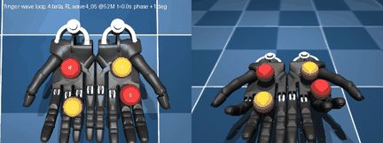
   </p>
   <p align="center"><sub>Stage 7A finger-wave loop, four balls: RL wave4_05 @52M, wrists flexed back
   0.05 (the first 10 s of 30, all kept, 11.0 laps for the slowest ball).</sub></p>

   **The crossing: a figure-8 across both hands.** Pattern A's balls do not follow each other round one
   loop -- they cross where the hands meet. `rl_env_stage7_fig8.Fig8Env` asks for a figure-8 over the two
   cupped hands, a 1:2 Lissajous `x = c_x + a_x sin 4 pi s, y = c_y + a_y sin 2 pi s` (crossing at the seam
   (32.2, 4.2) cm, half-axes 3.7 x 5.4 cm, 39 cm a lap): out across one hand's fingers to its index wall,
   back along its palm, through the crossing and round the other hand the other way. The base is the
   same finger wave, run outward from the seam on both hands, wrists flexed back 0.05; the residual
   policy does the rest. Reward: progress along the 8 (each ball's place `s` searched near its last one,
   so the crossing is not ambiguous; full pay at 0.5 laps/s), a cost per ball more than 1.5 cm off the 8,
   30 s episodes, -200 for a drop. The base alone never drops the ball and never gets it round (-0.1 to
   +0.2 laps).

   One ball (fig8_01, fresh, 20M): flat until ~6M -- the ball parked at a hand's outer end, where the
   path turns off the fingers onto the palm, and no constant forearm roll (-0.15 to +0.15) moved it --
   then it broke through: ~5 laps at 8M, ~12 at 14M.

   | fig8_01, deterministic, 30 s, 40 starts | kept | laps per 30 s (median) | under 1 lap |
   |---|---|---|---|
   | @12M | 40/40 | 8.7 | 4 |
   | @14M | 40/40 | 11.7 | 4 |
   | **@16M** | **40/40, and 40/40 on 40 fresh starts** | **12.3 (12.2 fresh)** | **0** |
   | @18M | 40/40 (40/40 fresh) | 12.0 (11.9) | 0 |
   | @20M | 40/40 | 10.8 | 1 |

   fig8_01 @16M runs the figure-8 at ~150 deg/s, a lap every 2.4 s. It is an 8, not a loop -- the ball
   crosses itself once each lap, the lobes turned opposite ways -- but a skewed one: the crossing sits
   ~2.7 cm palmward of the drawn one, and on the palm leg the ball comes within ~1 cm of the palms'
   heel, the edge four balls fell off on the loop.

   <p align="center">
     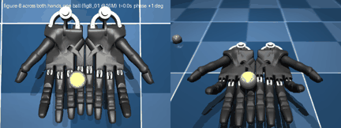
   </p>
   <p align="center"><sub>Stage 7A crossing figure-8, one ball: RL fig8_01 @16M (the first 10 s of 30;
   12.0 laps in the 30 s).</sub></p>

   More balls warm-start from fewer (`widen_stage7_fig8.py`): the first layer of the policy and value
   nets is widened, the new balls' inputs start at zero weight and their obs normalisation is copied from
   ball 0 -- the policy at first runs the old balls as before and ignores the new ones.

   Two balls (fig8_02, from fig8_01 @16M widened, 20M; started half a lap apart, offsets 0 and 3/4, so
   they reach the crossing by turns): at first the second ball sat still and four runs in five dropped a
   ball; by 4M both lapped (10/10 kept, ~2.5 laps), then it climbed slowly to the end.

   | fig8_02, deterministic, 30 s, 40 starts | kept | slowest ball, laps per 30 s (median) | under 1 lap |
   |---|---|---|---|
   | @12M | 40/40 | 4.2 | 2 |
   | @14M / 16M | 40/40 / 40/40 | 4.4 / 4.4 | 0 / 0 |
   | @18M | 39/40 | 5.3 | 1 |
   | **@20M** | **40/40, and 40/40 on 40 fresh starts** | **5.5 (5.5 fresh)** | **0** |

   fig8_02 @20M: **two balls run the figure-8 through the crossing by turns, 80/80 kept over 30 s,
   ~5.5 laps each** -- under half of one ball's 12. The balls do not keep half a lap apart: they bunch
   about a quarter lap apart and often touch (gap ~4 cm, 3.8 cm balls), so one holds the other up. It
   was still climbing at 20M.

   <p align="center">
     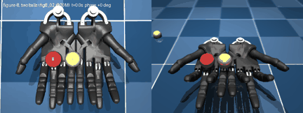
   </p>
   <p align="center"><sub>Stage 7A crossing figure-8, two balls: RL fig8_02 @20M (the first 10 s of 30;
   all kept, 6.0 laps for the slower ball).</sub></p>

   Three balls (fig8_03, from fig8_02 @20M widened, 20M; offsets 0, 1/3, 2/3 -- a closest pass of 5.7 cm
   at an even pace): 10/10 kept from 4M on, the speed climbing slowly.

   | fig8_03, deterministic, 30 s, 40 starts | kept | slowest ball, laps per 30 s (median) | under 1 lap |
   |---|---|---|---|
   | @12M / 14M | 40/40 / 40/40 | 2.6 / 2.6 | 1 / 0 |
   | @16M / 18M | 40/40 / 40/40 | 2.9 / 3.3 | 0 / 0 |
   | **@20M** | **40/40, and 40/40 on 40 fresh starts** | **3.5 (3.5 fresh)** | **0** |

   fig8_03 @20M: **three balls through the crossing, 80/80 kept over 30 s, ~3.5 laps each** (~45
   deg/s), still climbing at 20M. As with two, they bunch -- often all three on one hand -- and go
   over the crossing one after another rather than spread round the 8.

   <p align="center">
     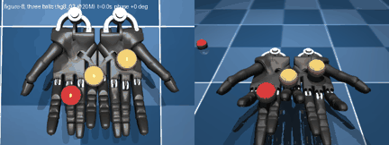
   </p>
   <p align="center"><sub>Stage 7A crossing figure-8, three balls: RL fig8_03 @20M (the first 10 s of 30;
   all kept, 4.1 laps for the slowest ball).</sub></p>

   Four balls cannot run the 8 at an even pace from the three-ball offsets: spaced k/8 they pass 2.8 cm
   apart, and the balls are 3.8 cm. A grid search over start offsets (moving at a constant rate in s,
   fast through the crossing, slow at the outer ends) finds 0, 0.396, 0.604, 0.792: a closest pass of
   4.0 cm. Even spacing along the path does worse (the best 3.7 cm; spaced a quarter lap they meet at
   the crossing). `Fig8Env.spacing` uses it for four.

   Four balls (fig8_04, from fig8_03 @20M widened, those offsets): the balls lapped from the start, and
   by 8M the drops were gone -- but the speed flattened from ~0.5M on.

   | fig8_04, deterministic, 30 s, 40 starts | kept | slowest ball, laps per 30 s (median) | under 1 lap |
   |---|---|---|---|
   | @4M | 35/40 | 1.1 | 15 |
   | @6M | 37/40 | 1.2 | 14 |
   | **@8M** | **40/40, and 38/40 on 40 fresh starts** | **1.35 (1.3 fresh)** | **10 (9)** |

   fig8_04 @8M keeps all four balls (78/80 over 30 s) and every ball crosses between the hands, 3-6
   times in 30 s -- but this is not yet the trick. The balls do not spread round the 8 at their
   offsets; they ride as a clump, three on one hand and one on the other half the time, churning
   slowly (~16 deg/s for the slowest ball, a ninth of one ball's speed). Nothing in the reward asks
   them to keep apart beyond the crowding cost: progress for the mean and the slowest ball is paid as
   well by a slow clump.

   | balls on the left hand, share of time | 0 | 1 | 2 | 3 | 4 |
   |---|---|---|---|---|---|
   | two balls (fig8_02 @20M) | 0.36 | 0.38 | 0.26 | | |
   | three balls (fig8_03 @20M) | 0.13 | 0.23 | 0.38 | 0.26 | |
   | four balls (fig8_04 @8M) | 0.14 | 0.14 | 0.20 | 0.47 | 0.05 |

   <p align="center">
     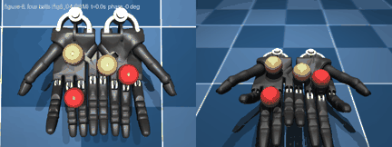
   </p>
   <p align="center"><sub>Stage 7A crossing figure-8, four balls: RL fig8_04 @8M (the first 10 s of 30;
   all kept, 1.7 laps for the slowest ball; the balls cross, but as a clump).</sub></p>

   fig8_04 @8M is the four-ball figure-8 result: four balls, all kept, every one through the crossing --
   as a clump. Three tries to spread the clump, all resumed from it, all negative:

   | run (from fig8_04 @8M) | what it adds | steps | slot spread (laps) | timetable error (laps) | slowest ball, deg per episode |
   |---|---|---|---|---|---|
   | fig8_05 | `--w-spread 0.5`: a cost per ball out of its slot relative to the others (`_slot_err`: s_k - offset_k about their circular mean) | +4.7M | 0.160 -> 0.164 | | 492 -> 525 |
   | fig8_06 | `--track-rate 0.08`: a timetable, each ball paid exp(-(err / 0.05)^2) for keeping its slot on a reference that runs round the 8 at 0.08 laps/s (progress no longer paid) | 4.6M | 0.165 -> 0.154 | 0.252 -> 0.246 | 512 -> 391 |
   | fig8_07 | the timetable at 0.06 laps/s, paid (1 + cos 2 pi err) / 2: half pay a quarter lap out | 12.3M | 0.163 -> 0.154 | 0.245 -> 0.214 | 498 -> 373 |

   (Averages over the first and last 20 training logs; a random timetable error is 0.25 laps.) Why:
   - the relative cost is met by balls stalled in their slots as well as by balls running in them --
     one of the four eval runs of fig8_04 already sat in its slots (0.05 laps out) going nowhere;
   - a timetable fixes that (a stalled ball falls out of its slot), but from the clump nearly every ball
     is a quarter lap out, where exp(-(err / 0.05)^2) pays nothing: no signal;
   - the dense cos timetable has a signal everywhere, and 12M steps moved the error from 0.245 to 0.214
     while the balls slowed: the policy learned the clump over 8M steps of progress pay, and one
     shared tilt moves all four balls on a hand together -- unlearning it is slow.

   Balls on the left hand, share of time: the timed pattern at those offsets has 1 / 2 / 3 balls there
   .21 / .58 / .21 of the time, never 0 or 4; fig8_04 @8M .14 / .20 / .47 with 0 or 4 .19; fig8_07 @4M
   .36 / .24 / .21 with 0 or 4 .18.

   So the timetable is trained in from the start instead: two balls first (from fig8_02, which has no clump
   habit yet), then widened to three and four with the timetable all the way.

   fig8_08 (two balls, timetable 0.1 laps/s, from fig8_02 @20M widened with zero-weight timetable inputs,
   15M steps): the balls slowed from ~5.5 to ~2.5 laps per 30 s, none lost, but the timetable error only went
   0.25 -> 0.18; in an episode it never settles (each third of it about as far out), the balls are not
   locked to their slots at any phase.

   **Can the hands time balls one by one at all?** (`probe_stage7_fig8.py`, a controllability probe, no
   training.) From states of a policy's own rollouts (one a second, 10-20 episodes), its next 0.5 s of actions
   are replayed open-loop, with each of the 42 actuators nudged +-0.3 in turn: the change in each ball's place
   on the 8 is a ball x actuator gain. For every pair of balls on one hand, every actuator is then pushed 0.5
   in the direction that should speed one past the other, and the change in their gap measured:

   | states from | same-hand pairs | aimed push: gap moved the right way | median gap gained in 0.5 s | random push, same size (undirected) |
   |---|---|---|---|---|
   | fig8_04 @8M (4 balls) | 499 | 91% | 0.066 laps | 0.039 laps |
   | fig8_02 @20M (2 balls, fast) | 163 | 68% | 0.057 laps | 0.069 laps |

   With no handle on single balls the aimed push would be right half the time. From the four-ball states it
   is right 91% of the time at ~0.13 laps/s, faster than the timetable itself: the hands CAN time balls one by
   one, so the clump is a learning problem, not a physical limit. (From the fast two-ball states less clearly:
   there the response is more chaotic.) It is carried mostly by the wrists (flex and side tilt), then the
   little finger and the forearm rolls: each lobe of the 8 runs out along the fingers and back along the
   palm, so one tilt pushes a ball on the finger leg and one on the palm leg OPPOSITE ways round the 8. The
   response is far from linear (the gains overstate it ~5x) and s is tracked in 0.002-lap steps, so the
   numbers give the scale, not more.

   Next: the timetable as staying alive (`--slot-tol`, DeepMimic's early termination): any ball further out
   of its slot than the tolerance ends the episode, the tolerance tightening from 0.4 laps to 0.1 as episodes
   last (`--slot-tol-min`; at 0.4 fig8_08's balls last only ~2.5 s).

   fig8_09 (from fig8_08 @14M, 15M steps): the median episode at 0.4 laps went 3.3 s -> ~11 s, the tolerance
   tightened to 0.35 at 27M. At 28M, run without the cut-off (seeds 500-509): ~3 laps per 30 s (the
   timetable's pace), the timetable error 0.14-0.15 laps all episode (fig8_08: ~0.22, drifting), 7/10 kept
   (the drops come where training never goes: a ball far out of its slot ends a training episode first).
   fig8_10 (from fig8_09's end, tightening at a 10 s median): at 0.35 the median stayed at 4-8 s for 8M steps.

   **Per-ball actions** (`--ball-act`, Fig8Env `_tilt`): n more actions, one per ball, each tilting the hand
   it is on (wrist flex for x, forearm roll for y, 0.1 rad per unit) so gravity pushes that ball along the 8's
   direction there (calibrated: +1 rad of WRJ1 tilts the palm normal ~-1 in x, +1 rad of FRJ ~-0.97 in y).
   The probe's hand-found mix, given as a handle. Open-loop on top of the policy's own actions, u = +1 for one
   ball and -1 for another on the same hand for 0.5 s: from fig8_04's four-ball states 95% of 499 pairs move
   apart the right way (median 0.067 laps; the probe's 42-actuator push 91%, 0.066), from fig8_10's two-ball
   states 79% of 29. `widen_stage7_fig8.py --ball-act` adds them to a policy at zero weight (it then acts
   exactly as before), and now also carries an old model's timetable inputs over. fig8_11: fig8_10 @37M with
   the per-ball actions, the slot tolerance from 0.35.

   fig8_11 tightened 0.35 -> 0.30 in 2.7M steps, then held (slot error 0.136 laps); fig8_12 (more tilt noise)
   changed nothing. At 0.1 laps/s the balls sat stuck 39% of the time at the 8's corners, so fig8_13 (from
   fig8_12 @16M) ran the timetable at 0.18 laps/s, the balls' own pace: tightened to 0.30 at 40M; @46M kept
   18/20, 4.6 laps / 30 s, slot error 0.136. Then three fixes, each found by looking at how episodes end:
   - **Spin-up** (`--grace 3`): balls start at rest and the timetable ran at full pace from t = 0, so half the
     episodes ended late in the first 0.6-3 s and the curriculum's median measured the spin-up (fig8_13b: 13M
     steps at 0.3, no tightening). For the first 3 s the timetable now sits on the balls' mean place. Same
     model, tol 0.3: median episode 2.7 s -> 16.6 s. fig8_14 tightened to 0.25, then held for 17M steps.
   - **Two balls 0.4 lap apart** (was 1/4): exactly half a lap apart they reach the crossing together (closest
     pass 0 cm); 0.4 is the nearest that clears (4.4 cm, balls 3.8 cm; the crossings 0.1 lap apart). Three
     balls stay at thirds (5.7 cm); four at the searched offsets (exact quarters collide too).
   - **Tilt reach** (`--tilt-k 0.3`, was 0.1): fig8_14's balls stalled at the outer walls (s ~0.25, 0.75),
     ~80% of it on the right hand. A ball's tilt action pushed +-1 for 0.5 s moved it 0.006-0.008 laps there
     (0.03 elsewhere, the right sign ~90% on both hands): too weak to unstall it; at 0.3 it moves it
     0.04-0.08. `widen --tilt-scale 1/3` rescales a model's tilt outputs so it starts exactly as before.

   fig8_16 (fig8_13 @46M rescaled, all three): tolerance 0.4 -> 0.2 in 2.8M steps, 0.15 at 8.6M, 0.1 (the
   curriculum's end) at 19.3M. A catch in judging it: the slot error is wrapped, so balls a whole lap behind
   read as on their slots. Run without the cut-off, the policy (which never saw errors past the tolerance)
   falls behind, and past half a lap the wrapped error says "ahead": both balls then wait a whole lap for the
   timetable (spacing kept; at 18M, 12 of 20 episodes ended 1-3 laps behind). (An earlier "0.10 laps median"
   for @8M was this wrapped error.) The fix for running a policy: a timetable that waits (`--lead 0.1`: it
   never leads the balls' mean place by more than 0.1 lap), so the policy's error stays in the range it was
   trained on. Deterministic, 20 episodes (seed 300):

   | | fig8_13 @46M | fig8_16 @8M | fig8_16 @18M | @18M, waiting timetable |
   |---|---|---|---|---|
   | kept | 15/20 | 19/20 | 20/20 | 20/20 |
   | laps / 30 s, mean (p10) (timetable 5.4) | 3.8 | 4.7 (3.4) | 4.2 (3.1) | 4.8 (4.2) |
   | spacing error (each ball vs the other's slot), median | - | 0.060 | 0.048 | 0.043 laps |
   | both balls within 0.1 lap of their slots | - | 51% | 59% | 71% |
   | timetable waited | - | - | - | 0.4 laps / episode |

   

   After the tolerance reached 0.1 (19.3M), fig8_16 fell apart: laps / 30 s (waiting timetable, 10 episodes)
   4.6 @20M, 2.6 @22M, 1.4 @24M, 0.8 @30M. In the spin-up the timetable sits on the balls, and spaced balls
   were paid in full even standing still; at 0.1 episodes end soon after the spin-up, so standing still
   through it became the best policy. Fixed: in the spin-up a ball is paid only as far as it moves at the
   timetable's pace. The two-ball result is fig8_16 @18M.

   Three balls, 1/3 lap apart. fig8_17 (fig8_16 @18M widened to three balls): 40M steps without one
   tightening; the balls never got moving (0.1-0.6 laps / 30 s at every checkpoint, spacing 0.04-0.07).
   Widened, the two-ball policy moved three balls 0.24 laps / 30 s, and with a lost ball costing 200 and a
   late one nothing, waiting to be cut off is the safe play. fig8_18 starts instead from fig8_03 (three balls
   running free, clumped: 10/10 kept, 3.7 laps / 30 s, spacing error 0.21) with the timetable at its own
   pace, 0.13 laps/s, the way the two-ball runs started from fig8_02's lineage.
   fig8_18: 8M steps at 0.4 without a tightening, a quarter of its episodes ending just after the spin-up
   with one ball 0.4 lap out of its slot (unchecked in the spin-up, it clumped). With the tolerance applied
   there too (to spacing), fig8_19 (from fig8_18 @8M) tightened 0.4 -> 0.25 by 21.3M; @20M (waiting
   timetable, 10 episodes): 10/10 kept, 3.4 laps / 30 s (timetable 3.9), spacing error 0.15 laps (0.18 at
   the start). It went on to 0.2 at 30.3M (@40M: 10/10, 3.6 laps, spacing error 0.125, all three balls
   within 0.1 lap of their slots 19% of the time) and 0.15 at 44.5M, after which it slowed as fig8_16 did
   (final @48M: 1.6 laps / 30 s, the timetable waiting 1.9 laps). Past what it can hold, slow and spaced is
   the safe play: being cut off late costs only the pay forgone. fig8_20 went on from @40M with the tolerance
   held at 0.2: no slowing; @52M 10/10 kept, 3.8 laps / 30 s (on the timetable; it never waited), spacing
   error 0.129 (flat), all three within 0.1 lap 24% (from 18%). The three-ball result for now. fig8_21 goes on
   from it tightening again, a late end now costing 100 (`--late-cost`, half a drop).
   fig8_21 tightened to 0.15 at once and then dropped balls instead (kept 4/10 @62M; spacing 0.105-0.117).
   The common cause of all three breakdowns: once tight, episodes from a standing start end in 3-5 s, so
   nearly all training is the spin-up and the steady circulation drifts. Two fixes:
   - **Mid-run starts** (`bank_stage7_fig8.py`, `--bank --p-bank`): 571 states from fig8_20 @52M with every
     ball within 0.1 lap of its slot; half the episodes start from one, past the spin-up (checked: a bank
     start replays identically).
   - **Natural-pace timetable** (`--pace`): even from a bank state the policy held 0.15 for under a second.
     The slot error swings with the place on the 8 (peak-to-peak 0.17 lap, 27% of its variance): balls go
     round the outer walls ~5x slower than through the crossing (0.05 vs 0.25 laps/s), and a clock even in s
     reads that as falling behind and catching up every lap. With the clock at the balls' measured pace
     (`data/pace_fig8_3.npy`, symmetric over the two halves; slots even in time), fig8_20 @52M unchanged:
     spacing error 0.129 -> 0.112, all three within 0.1 lap 24% -> 36% of the time, within 0.15 79% -> 98%.
   fig8_22: from fig8_20 @52M with both, tightening from 0.2. It reached 0.15 at once (52.3M) and 0.1 at 60.1M,
   then collapsed (@64M: 5/10 kept, 1.5 laps), the third run to break at 0.1 (fig8_19, fig8_21). Best @54M, on 20
   fresh episodes against fig8_20 @52M (both on the natural-pace clock, waiting timetable): 19/20 kept for both,
   3.2 vs 3.4 laps, spacing error 0.106 vs 0.112, all three within 0.1 lap 40% vs 33% of the time: a small gain.
   The three-ball result: thirds of a lap apart, about a tenth of a lap off slot, ~3.3 laps / 30 s.

   Gallery, in training order (best of the episodes recorded for each):

   | | two balls | |
   |---|---|---|
   | fig8_02, free running |  | moving, clumped; the start |
   | fig8_08, timetable 0.1 laps/s | 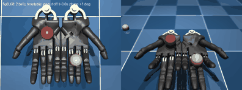 | slot error ~0.22 |
   | fig8_09 @28M, slot cut-off | 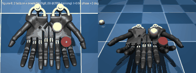 | error ~0.15, 7/10 kept |
   | fig8_13 @18M, timetable 0.18 | 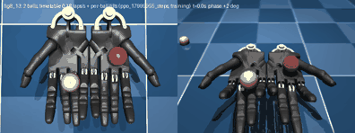 | 8/10 kept, ~3 laps / 30 s |
   | fig8_13 @46M | 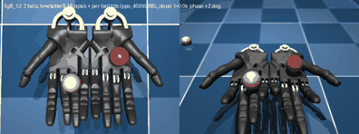 | 18/20 kept, 4.6 laps |
   | fig8_14 @78M, 1/4-lap gap, spin-up | 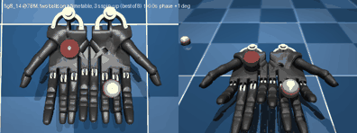 | slower, ~4 laps |
   | fig8_16 @8M, 0.4-lap gap, tilt 0.3 | 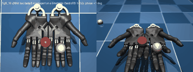 | 19/20 kept, 4.7 laps |
   | **fig8_16 @18M, the result** |  | 20/20, 4.8 laps, spacing error 0.043 |
   | fig8_16 @30M, collapsed | 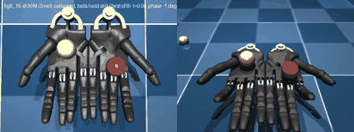 | balls held still (the spin-up loophole) |

   | | three balls | |
   |---|---|---|
   | fig8_03, free running |  | 3.7 laps, clumped; fig8_18's start |
   | fig8_17 @40M, from the two-ball policy | 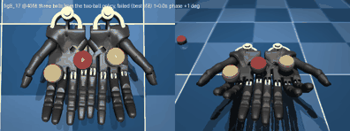 | failed: the balls barely move |
   | fig8_19 @20M, from fig8_03, timetable 0.13 | 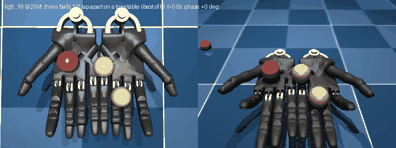 | 10/10 kept, 3.4 laps, spacing error 0.15 |
   | **fig8_22 @54M, the result** (pace clock, mid-run starts) | 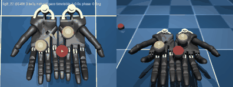 | 19/20 kept, 3.2 laps, spacing error 0.106 |
   | fig8_25 @62M, gap-scaled pay (`--clear 1`, retrain) | 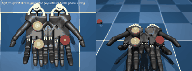 | 37/40 kept, 3.3 laps, touching 12% of the time (fig8_22 @54M: 24%) |

   ```
   python3 stage7_cup.py --out media_full/stage7_cup.png                  # the cup: settle + hold tests
   python3 stage7_cup.py --swirl --flicks 0.6                             # swirl + flick grid
   python3 train_stage7_cup.py --run-name cup_01 --log-std -2.0
   python3 stage7_wave.py                                                 # the wave conveyor, one ball, grid
   python3 stage7_wave_loop.py --fsm                                      # the scripted loop with feedback tilts
   python3 train_stage7_cup.py --env wave --run-name wave_01 --ref-deg 180 --timesteps 20000000
   python3 eval_stage7_cup.py runs/wave_02/checkpoints/ppo_23999940_steps.zip --env wave --n 20 --seconds 10
   python3 eval_stage7_cup.py runs/wave_02/checkpoints/ppo_23999940_steps.zip --env wave --settled --seconds 30 --record data/stage7_wave_rl24M.npz
   python3 render_stage7.py data/stage7_wave_rl24M.npz media_full/stage7_wave_rl24M.gif --every 2
   python3 train_stage7_cup.py --env wave --n-balls 2 --run-name wave2_01 --ref-deg 180 --log-std -1.5 --timesteps 30000000
   python3 eval_stage7_cup.py runs/wave2_01/checkpoints/ppo_17999955_steps.zip --env wave --n-balls 2 --n 10 --seconds 30 --seed 500 --record data/stage7_wave2_rl18M.npz
   python3 render_stage7.py data/stage7_wave2_rl18M.npz media_full/stage7_wave2_rl18M.gif --every 3
   python3 train_stage7_cup.py --env wave --n-balls 4 --run-name wave4_01 --ref-deg 180 --log-std -1.5 --timesteps 40000000
   python3 eval_stage7_cup.py runs/wave4_01/checkpoints/ppo_39999900_steps.zip --env wave --n-balls 4 --n 10 --seconds 30 --seed 500 --record data/stage7_wave4_rl40M.npz
   python3 train_stage7_cup.py --env wave --n-balls 4 --w-edge 0.5 --w-fast 0.5 --run-name wave4_03 --ref-deg 180 --resume runs/wave4_02/checkpoints/ppo_45999885_steps.zip --timesteps 10000000
   python3 eval_stage7_cup.py runs/wave4_03/checkpoints/ppo_49999875_steps.zip --env wave --n-balls 4 --flex-n -0.05 --n 10 --seconds 30 --seed 500 --record data/stage7_wave4_flex05.npz
   python3 train_stage7_cup.py --env wave --n-balls 4 --flex-n -0.05 --drop 200 --episode-seconds 30 --run-name wave4_05 --ref-deg 180 --resume runs/wave4_03/checkpoints/ppo_49999875_steps.zip --timesteps 10000000
   python3 eval_stage7_cup.py runs/wave4_05/checkpoints/ppo_51999870_steps.zip --env wave --n-balls 4 --flex-n -0.05 --n 10 --seconds 30 --seed 500 --record data/stage7_wave4_05_52M.npz
   python3 train_stage7_cup.py --env fig8 --run-name fig8_01 --ref-deg 180 --episode-seconds 30 --drop 200 --log-std -1.5 --timesteps 20000000
   python3 eval_stage7_cup.py runs/fig8_01/checkpoints/ppo_15999960_steps.zip --env fig8 --n 10 --seconds 30 --seed 500 --record data/fig8_01_16M.npz
   python3 widen_stage7_fig8.py runs/fig8_01/checkpoints/ppo_15999960_steps.zip 2 runs/fig8_02/init/ppo_0_steps.zip
   python3 train_stage7_cup.py --env fig8 --n-balls 2 --run-name fig8_02 --resume runs/fig8_02/init/ppo_0_steps.zip --ref-deg 180 --episode-seconds 30 --drop 200 --timesteps 20000000
   python3 eval_stage7_cup.py runs/fig8_02/checkpoints/ppo_19999950_steps.zip --env fig8 --n-balls 2 --n 10 --seconds 30 --seed 500 --record data/fig8_02_20M.npz
   python3 widen_stage7_fig8.py runs/fig8_02/checkpoints/ppo_19999950_steps.zip 3 runs/fig8_03/init/ppo_0_steps.zip
   python3 train_stage7_cup.py --env fig8 --n-balls 3 --run-name fig8_03 --resume runs/fig8_03/init/ppo_0_steps.zip --ref-deg 180 --episode-seconds 30 --drop 200 --timesteps 20000000
   python3 eval_stage7_cup.py runs/fig8_03/checkpoints/ppo_19999950_steps.zip --env fig8 --n-balls 3 --n 10 --seconds 30 --seed 500 --record data/fig8_03_20M.npz
   python3 widen_stage7_fig8.py runs/fig8_03/checkpoints/ppo_19999950_steps.zip 4 runs/fig8_04/init/ppo_0_steps.zip
   python3 train_stage7_cup.py --env fig8 --n-balls 4 --run-name fig8_04 --resume runs/fig8_04/init/ppo_0_steps.zip --ref-deg 180 --episode-seconds 30 --drop 200 --timesteps 30000000
   python3 eval_stage7_cup.py runs/fig8_04/checkpoints/ppo_7999980_steps.zip --env fig8 --n-balls 4 --n 10 --seconds 30 --seed 500 --record data/fig8_04_8M.npz
   python3 train_stage7_cup.py --env fig8 --n-balls 4 --run-name fig8_05 --resume runs/fig8_04/checkpoints/ppo_7999980_steps.zip --w-spread 0.5 --ref-deg 180 --episode-seconds 30 --drop 200 --timesteps 20000000
   python3 widen_stage7_fig8.py runs/fig8_04/checkpoints/ppo_7999980_steps.zip 4 runs/fig8_07/init/ppo_0_steps.zip --track-rate 0.06
   python3 train_stage7_cup.py --env fig8 --n-balls 4 --run-name fig8_07 --resume runs/fig8_07/init/ppo_0_steps.zip --track-rate 0.06 --ref-deg 180 --episode-seconds 30 --drop 200 --timesteps 20000000
   python3 widen_stage7_fig8.py runs/fig8_02/checkpoints/ppo_19999950_steps.zip 2 runs/fig8_08/init/ppo_0_steps.zip --track-rate 0.1
   python3 train_stage7_cup.py --env fig8 --n-balls 2 --run-name fig8_08 --resume runs/fig8_08/init/ppo_0_steps.zip --track-rate 0.1 --ref-deg 180 --episode-seconds 30 --drop 200 --timesteps 15000000
   python3 probe_stage7_fig8.py runs/fig8_04/checkpoints/ppo_7999980_steps.zip 4 --seeds 10 --out data/probe_fig8_4.npz
   python3 probe_stage7_fig8.py runs/fig8_02/checkpoints/ppo_19999950_steps.zip 2 --seeds 20 --seed0 800 --out data/probe_fig8_2.npz
   python3 train_stage7_cup.py --env fig8 --n-balls 2 --run-name fig8_09 --resume runs/fig8_08/checkpoints/ppo_13999965_steps.zip --track-rate 0.1 --slot-tol 0.4 --slot-tol-min 0.1 --ref-deg 180 --episode-seconds 30 --drop 200 --timesteps 15000000
   python3 train_stage7_cup.py --env fig8 --n-balls 2 --run-name fig8_10 --resume runs/fig8_10/init/ppo_29022045_steps.zip --track-rate 0.1 --slot-tol 0.35 --slot-tol-min 0.1 --slot-seconds 10 --ref-deg 180 --episode-seconds 30 --drop 200 --timesteps 30000000
   python3 widen_stage7_fig8.py runs/fig8_10/checkpoints/ppo_37022025_steps.zip 2 runs/fig8_11/init/ppo_0_steps.zip --track-rate 0.1 --ball-act
   python3 train_stage7_cup.py --env fig8 --n-balls 2 --run-name fig8_11 --resume runs/fig8_11/init/ppo_0_steps.zip --track-rate 0.1 --ball-act --slot-tol 0.35 --slot-tol-min 0.1 --slot-seconds 10 --ref-deg 180 --episode-seconds 30 --drop 200 --timesteps 30000000
   python3 widen_stage7_fig8.py runs/fig8_13/checkpoints/ppo_45999885_steps.zip 2 runs/fig8_16/init/ppo_0_steps.zip --track-rate 0.18 --ball-act --tilt-scale 0.3333333
   python3 train_stage7_cup.py --env fig8 --n-balls 2 --run-name fig8_16 --resume runs/fig8_16/init/ppo_0_steps.zip --track-rate 0.18 --ball-act --tilt-k 0.3 --grace 3 --slot-tol 0.4 --slot-tol-min 0.1 --slot-seconds 10 --ref-deg 180 --episode-seconds 30 --drop 200 --timesteps 30000000
   python3 eval_stage7_cup.py runs/fig8_16/checkpoints/ppo_7999980_steps.zip --env fig8 --n-balls 2 --track-rate 0.18 --ball-act --tilt-k 0.3 --grace 3 --n 8 --seed 500 --record data/fig8_16_8M.npz
   python3 eval_stage7_cup.py runs/fig8_16/checkpoints/ppo_17999955_steps.zip --env fig8 --n-balls 2 --track-rate 0.18 --ball-act --tilt-k 0.3 --grace 3 --lead 0.1 --n 8 --seed 500 --record data/fig8_16_18M.npz
   python3 widen_stage7_fig8.py runs/fig8_03/checkpoints/ppo_19999950_steps.zip 3 runs/fig8_18/init/ppo_0_steps.zip --track-rate 0.13 --ball-act
   python3 bank_stage7_fig8.py runs/fig8_20/checkpoints/ppo_51999870_steps.zip 3 --track-rate 0.13 --tilt-k 0.3 --out data/bank_fig8_3.npz
   python3 train_stage7_cup.py --env fig8 --n-balls 3 --run-name fig8_22 --resume runs/fig8_22/init/ppo_51999870_steps.zip --track-rate 0.13 --pace data/pace_fig8_3.npy --bank data/bank_fig8_3.npz --p-bank 0.5 --ball-act --tilt-k 0.3 --grace 3 --slot-tol 0.2 --slot-tol-min 0.1 --slot-seconds 10 --ref-deg 180 --episode-seconds 30 --drop 200 --timesteps 30000000
   python3 train_stage7_cup.py --env fig8 --n-balls 3 --run-name fig8_18 --resume runs/fig8_18/init/ppo_0_steps.zip --track-rate 0.13 --ball-act --tilt-k 0.3 --grace 3 --slot-tol 0.4 --slot-tol-min 0.1 --slot-seconds 10 --ref-deg 180 --episode-seconds 30 --drop 200 --timesteps 40000000
   ```

## Repository layout

```
shadow_hand/
├── assets/
│   ├── right_hand.xml, left_hand.xml, scene_right.xml, keyframes.xml   # vendored, see NOTICE.md
│   ├── assets/                            # meshes (vendored)
│   ├── LICENSE.shadow_hand, CHANGELOG.shadow_hand.md, NOTICE.md
│   ├── scene_one_ball.xml                 # Stage 2: hand + one 45mm ball
│   ├── scene_two_balls.xml                # Stage 3: hand + two 45mm balls
│   ├── scene_three_balls.xml              # Stage 6: hand + three 45mm balls
│   └── scene_three_balls_slick.xml        # Stage 6: the same, polished (ball-ball friction 0.15)
├── hand_env.py                            # names, palmar_axis, contact-face classifier, grasp/hold tests
├── eval_stage1_verify.py                  # Stage 1: tracking / palmar axis / coupling / gravity checks
├── demo_stage1_kinematic_sweep.py         # Stage 1: actuator sweep GIF
├── eval_stage2_classifier.py              # Stage 2: classifier probe check
├── search_stage2_grasp.py                 # Stage 2: CEM grasp search
├── eval_stage2_hold.py                    # Stage 2: six-direction hold + perturbation test
├── search_stage3_bowl.py                  # Stage 3: CEM bowl search (two balls)
├── show_stage3_bowl.py                    # Stage 3: palm-aligned render of a bowl
├── search_stage4_baoding.py               # Stage 4: CEM over the press wave / circular motion
├── demo_stage4_baoding.py                 # Stage 4: controller + ideal-push GIF
├── rl_env_baoding.py                      # Stage 5 runs 01-06: first RL env (style rewards)
├── rl_env_baoding2.py                     # Stage 5 runs 07+: BaodingEnv2..9 (motion-only reward)
├── train_stage5_baoding_rl.py             # Stage 5: PPO training, --env 1-9, ball-size curriculum
├── demo_stage5_baoding_rl.py              # Stage 5: rollout GIF for runs 01-06
├── demo_stage5_baoding_rl2.py             # Stage 5: rollout GIF + per-digit work for runs 07+
├── eval_stage5_baoding.py                 # Stage 5: swaps / drops over randomized starts
├── data/stage5_bowl_e_50mm.json           # Stage 5: bowl e for 50mm balls (BaodingEnv6)
├── three_balls.py                         # Stage 6: three-ball scene helpers
├── eval_stage6_hold.py, eval_stage6_push.py        # Stage 6: bowl hold / ideal-push checks, three balls
├── rl_env_baoding3.py, eval_stage6_baoding.py      # Stage 6: Stage 5 RL recipe on three balls (three_01-06)
├── collect_stage6_jam_states.py           # Stage 6: jam / passage start states (three_06)
├── eval_stage6_circle_hold.py             # Stage 6 step 1: holdability of every phase (Probe)
├── eval_stage6_posture_sweep.py           # Stage 6 step 2: blended hold postures
├── stage6_teacher.py                      # Stage 6 step 3: segment planner (labeled clicks, backtracking, tip cost)
├── stage6_mpc.py                          # Stage 6 step 3: closed-loop predictive-sampling MPC
├── rl_env_track3.py                       # Stage 6 step 4: tracking env (circle / demo timing)
├── train_stage6_track.py, eval_stage6_track.py     # Stage 6 step 4: PPO (+ BC) and evaluation
├── eval_stage6_demo_replay.py             # Stage 6: open-loop replay scan of a planner demo
├── two_hands.py                           # Stage 7: two-hand scene (MjSpec), mirror check
├── stage7_two_hands.py                    # Stage 7B: Stage 5 policy on both hands via per-hand proxies
├── stage7_layout.py                       # Stage 7A: touching-palms layout, four balls at the seam
├── stage7_teacher.py                      # Stage 7A: two-hand segment planner (wrist tilt, finger band, resume)
├── render_stage7.py, demo_stats.py        # Stage 7A: render a demo/episode npz; demo smoothness stats
├── rl_env_stage7.py, eval_stage7_track.py # Stage 7A: two-hand tracking env; evaluation
├── stage7_stalls.py                       # Stage 7A: save a policy's stall states for planner fixes
├── stage7_mpc.py, stage7_rhythm.py, stage7_cross.py   # Stage 7A form (2): MPC, rhythm CEM, crossing cycle
├── rl_env_stage7_loop.py, train_stage7_loop.py, eval_stage7_loop.py  # Stage 7A form (2): loop RL / tracking
├── stage7_cup.py                          # Stage 7A: the long cup (hold tests, swirl + flick grids)
├── rl_env_stage7_cup.py, train_stage7_cup.py, eval_stage7_cup.py     # Stage 7A: cup RL; --env wave: finger-wave RL
├── stage7_wave.py, stage7_wave_loop.py    # Stage 7A: the finger-wave conveyor; the scripted loop (--fsm)
├── rl_env_stage7_wave.py                  # Stage 7A: finger-wave loop RL env (one ball; MultiWaveEnv: 2-4)
├── rl_env_stage7_fig8.py                  # Stage 7A: the crossing figure-8 across both hands (Fig8Env, 1-4 balls)
├── widen_stage7_fig8.py                   # Stage 7A: warm-start an n-ball figure-8 policy from fewer balls
├── data/stage6_*.npz                      # Stage 6: hold postures, jam states, the planner demos
├── data/stage7_demo_*.npz                 # Stage 7A: the planner demos (ccw360 = first, smooth360 = used)
├── logs/                                  # Stage 5-7: training / planner output of every run
├── media/
│   ├── stage1_kinematic_sweep.gif
│   ├── stage2_grasp_*.png                 # grasp renders, a-e in search order (d = final)
│   ├── stage3_*.png                       # bowl renders (stage3_bowl_e = final)
│   ├── stage4_*.gif                       # scripted baoding attempts + ideal-push test
│   ├── stage5_baoding_*.gif               # RL baoding, every run (15_60M = final)
│   ├── stage6_three_ball_hold.png         # three balls in the bowl
│   ├── stage6_pads_two_circles.gif        # Stage 6: the planner demo, 825 deg, pads only
│   ├── stage6_rl_1021deg.gif              # Stage 6: RL (track_03), 1021 deg in 30 s, pads only
│   ├── stage6_rl_1206deg.gif              # Stage 6: RL (track_06), 1206 deg in 38 s, then a drop
│   ├── stage6_rl_five_circles.gif         # Stage 6: RL (track_07), 1818 deg in 60 s, no ball lost
│   ├── stage6_rl_20of24.gif               # Stage 6: RL (track_08), 20/24 kept 60 s at 2.5x; 1733 deg shown
│   ├── stage6_rl_1x.gif                   # Stage 6: RL (track_10), 21/24 kept 60 s at 1x; 738 deg shown
│   ├── stage7_two_hands_B.gif             # Stage 7B: two hands, a pair each, 11 swaps per hand in 20 s
│   ├── stage7A_smooth_demo.gif            # Stage 7A: the smooth planner demo, 364 deg across both palms
│   ├── stage7A_rl_14M.gif                 # Stage 7A: RL (two_01 @14M), 30 s kept at 1x, +68 deg
│   ├── stage7_track_l3_40M_1x.gif         # Stage 7A form (2): RL track_l3, kept but not circulating
│   ├── stage7_cup_rl16M.gif               # Stage 7A: the long cup, RL cup_01 parks the balls
│   ├── stage7_wave_a.gif                  # Stage 7A: the finger wave carries one ball along the row
│   ├── stage7_wave_rl24M.gif              # Stage 7A: RL wave_02 @24M, one ball, a lap every ~2 s
│   ├── stage7_wave2_rl18M.gif             # Stage 7A: RL wave2_01 @18M, two balls round the loop
│   ├── stage7_wave4_rl40M.gif             # Stage 7A: RL wave4_01 @40M, four balls round the loop
│   ├── stage7_wave4_flex05.gif            # Stage 7A: four balls, @50M on wrists flexed -0.05: 47/50 kept
│   ├── stage7_wave4_05_52M.gif            # Stage 7A: four balls, RL wave4_05 @52M: 49/50 kept, ~10 laps/30 s
│   ├── stage7_fig8_one.gif                # Stage 7A: the crossing figure-8, one ball, RL fig8_01 @16M
│   ├── stage7_fig8_two.gif                # Stage 7A: the crossing figure-8, two balls, RL fig8_02 @20M
│   ├── stage7_fig8_three.gif              # Stage 7A: the crossing figure-8, three balls, RL fig8_03 @20M
│   └── stage7_fig8_four.gif               # Stage 7A: the crossing figure-8, four balls, RL fig8_04 @8M (a clump)
└── README.md
```
